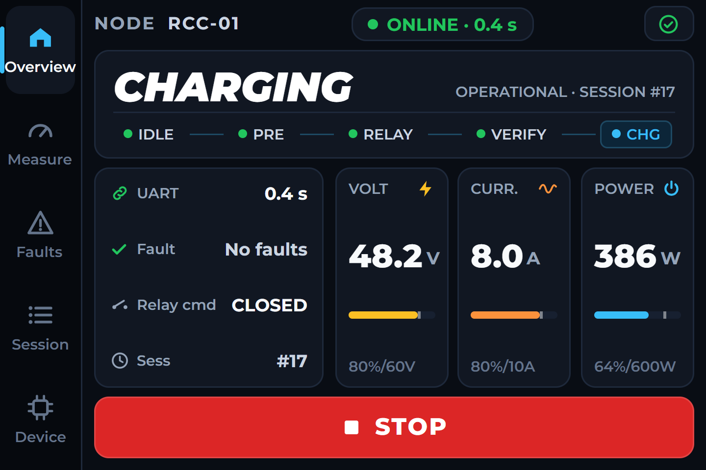
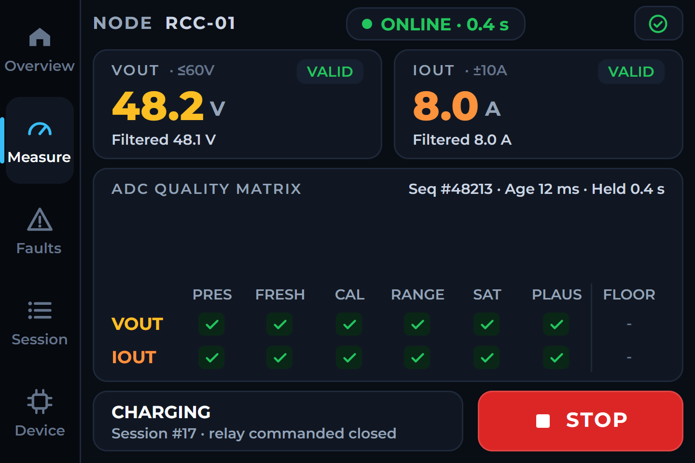
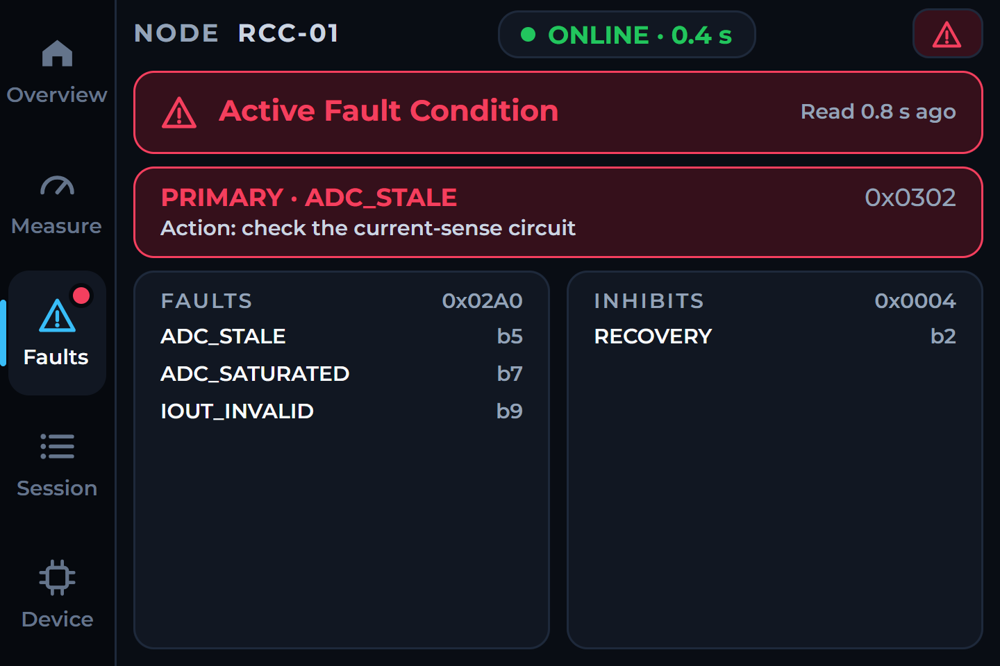
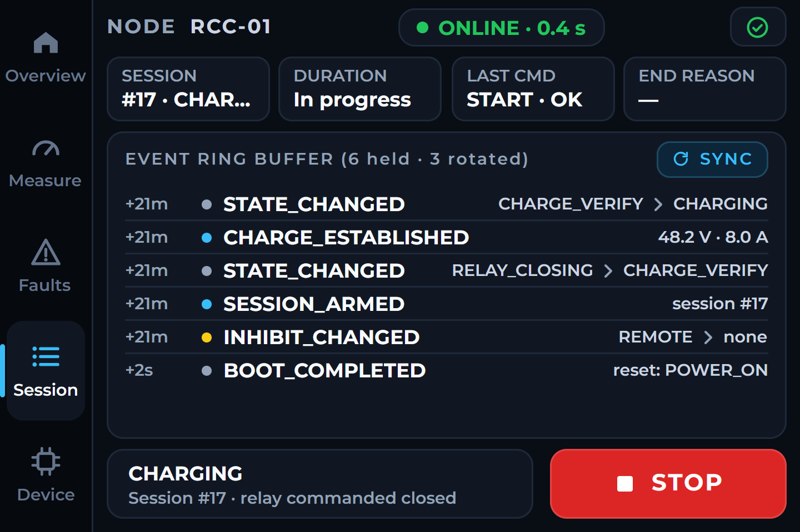
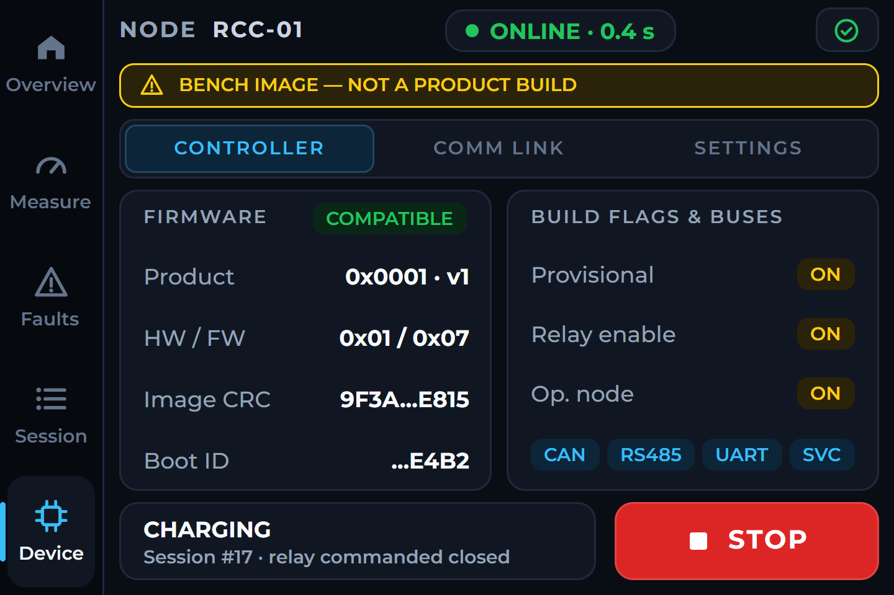
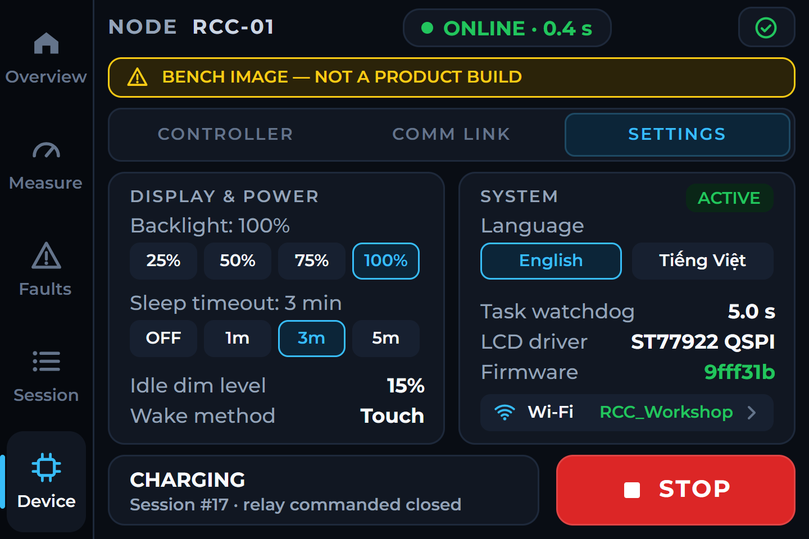
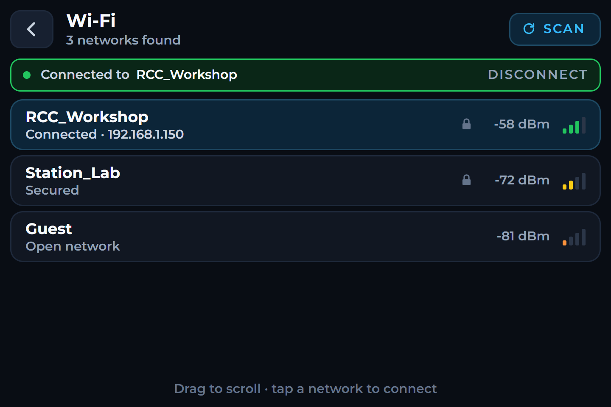

  <h1>Robot Charge Controller HMI</h1>
  
<strong>An Elecrow ESP32-S3 touchscreen interface for the Robot Charge Controller.</strong>

  

    
    
    
    
    
  

  

    <a href="#interface-preview">Interface</a> &middot;
    <a href="#firmware-architecture">Architecture</a> &middot;
    <a href="#build-and-upload">Build &amp; Upload</a> &middot;
    <a href="#controller-simulator">Simulator</a> &middot;
    <a href="#automated-tests">Tests</a> &middot;
    <a href="#documentation">Documentation</a>
  

## Interface Preview

Five pages cover live monitoring, charging controls and controller diagnostics;
Device also holds the local settings and Wi-Fi screens. Select any preview to view
the full-size image.

<table align="center">
  <tr>
    <td align="center" width="50%">
       
      <strong>Overview</strong> 
      Charging state and controls
    </td>
    <td align="center" width="50%">
       
      <strong>Measure</strong> 
      Measurements and data quality
    </td>
  </tr>
  <tr>
    <td align="center" width="50%">
       
      <strong>Faults</strong> 
      Faults and safety interlocks
    </td>
    <td align="center" width="50%">
       
      <strong>Session</strong> 
      Session details and event history
    </td>
  </tr>
  <tr>
    <td align="center" width="50%">
       
      <strong>Device</strong> 
      Controller identity and diagnostics
    </td>
    <td align="center" width="50%">
       
      <strong>Settings</strong> 
      Display, language and system information
    </td>
  </tr>
  <tr>
    <td align="center" colspan="2">
       
      <strong>Wi-Fi</strong> 
      Network selection; the connected view enables Web OTA
    </td>
  </tr>
</table>

  <em>High-resolution captures of the <a href="docs/mockups/hmi-ui-landscape.html">interactive UI reference</a>,
  a browser port of the firmware UI (<code>firmware/components/ui</code>), with illustrative data. Not photographs of the display
  or recorded charging sessions.</em>

Regenerate the previews

The 1440 × 960 PNGs in `assets/ui/` are 3× captures of the
[interactive UI reference](docs/mockups/hmi-ui-landscape.html), which mirrors
the firmware UI. From the repository root (needs Microsoft Edge, or pass
`--browser chrome`):

~~~sh
python -m pip install playwright
python tools/snapshot/export_mockup_previews.py --scale 3
~~~

To check the reference against the firmware itself, `tools/snapshot/` also builds
a PC renderer of the UI components with LVGL (480 × 320, pixel-exact). Build the firmware
once so `firmware/managed_components/` contains LVGL, then:

~~~sh
cmake -S tools/snapshot -B build-snapshot -G Ninja -DCMAKE_C_COMPILER=gcc
cmake --build build-snapshot
mkdir -p build-snapshot/bmp
build-snapshot/hmi_render build-snapshot/bmp
~~~

`python tools/snapshot/export_previews.py build-snapshot/bmp` writes these renders
to `assets/ui/` at 2× instead (needs Pillow).

For every page and state, including commands, simulated V/I and the Wi-Fi and OTA
screens, open the [interactive UI reference](docs/mockups/hmi-ui-landscape.html)
in a browser.

## Overview

Robot Charge Controller HMI targets the **Elecrow DLE06235B / ES3C35P ESP32-S3**
in **480 × 320 landscape** orientation, using **ESP-IDF (`idf.py`) and LVGL**.
The five-page UI is integrated with the RCC protocol transport on **UART1,
TX GPIO43 / RX GPIO44, 115200 8N1**. The firmware attempts to start this link
once the display is initialized. Physical wiring and end-to-end controller
operation still require verification.

Charging decisions, interlocks and relay control remain owned by the controller.

On 2026-11-27 the firmware moved from PlatformIO to a plain ESP-IDF project and
was split into layered components (see [Firmware Architecture](#firmware-architecture)).
Behavior and UI are unchanged: the desktop simulator renders all 80 checked
screens pixel-identical to the former PlatformIO source. The restructured image
has not yet been flashed to a board. Source implementation and earlier bring-up
observations are distinguished from hardware acceptance throughout.

## UI Pages

| Page | Information |
|---|---|
| Overview | Charging state, stage strip, link freshness, voltage/current/power and START/STOP |
| Measure | Raw and filtered measurements, validity bits and sample age |
| Faults | Primary fault, active fault mask and inhibit reasons |
| Session | Session information, last command result and recent events |
| Device | Controller identity, build flags, link diagnostics, display settings and Wi-Fi |

## Technical Specifications

| Item | Configuration |
|---|---|
| Board | Elecrow DLE06235B / ES3C35P, ESP32-S3 |
| Display | ST77922 QSPI, native 320 × 480; LVGL landscape 480 × 320 |
| Touch | Integrated capacitive touch, ST77922 I²C at 0x55 |
| Flash / PSRAM | 16 MB / 8 MB |
| Build system | ESP-IDF `idf.py` (CMake, component manager) |
| Framework | ESP-IDF 6.1.0 |
| UI | LVGL 9.6.0 |
| Controller link | UART1, TX GPIO43 / RX GPIO44, 115200 8N1, 3.3 V logic |
| Local settings | NVS-backed brightness, inactivity dimming and language selection |
| Networking / update | Wi-Fi station and HTTP Web OTA; two 3.5 MiB app slots |

## Key Features

- Five touchscreen pages with output voltage, current and calculated power.
- Measurement validity, freshness and filtered values.
- Controller state, relay command, faults and inhibit masks.
- Session information and controller event log.
- Device identity, build flags and UART diagnostics.
- START confirmation, STOP requests and command-result feedback.
- Lost-link and unconfirmed-command indications.
- Python controller simulator through a separate USB-to-UART adapter.
- Display settings and inactivity dimming, persisted in NVS.
- Wi-Fi scan/connect/forget screens and saved credentials.
- Web OTA update service with dual app slots and boot rollback configured.

The language setting is stored, but the main UI labels remain English. See
[local settings, Wi-Fi and OTA](docs/settings-wifi-and-ota.md) for current behavior
and implementation limits.

## Project Status

| Area | Current state |
|---|---|
| Firmware build | 2026-11-27: `idf.py build` (ESP-IDF 6.1.0) from a clean tree, 0 warnings with `-Wall -Wextra -Werror` on project components |
| Firmware structure | ESP-IDF components by layer; `sdkconfig` generated from `sdkconfig.defaults` matches the former PlatformIO configuration except the partition file name |
| Display and touch | Earlier bring-up of the PlatformIO image reports LCD/touch operation; the restructured image is not yet flashed |
| C host tests | 2026-11-27: `rcc_codec`, `hmi_present` (304 checks) and `rcc_link` pass |
| Desktop UI simulator | 2026-11-27: 80 screens pixel-identical to the PlatformIO baseline; retained-mode updates identical to fresh builds |
| UART simulator host tests | 2026-11-27: 33 discovered; 32 passed, 1 skipped (optional independent codec comparison) |
| Controller simulator link | Transport compiled into target; physical adapter-to-HMI test pending |
| Settings, Wi-Fi and Web OTA | Implemented; hardware acceptance and rollback tests pending |
| Touch-driven START/STOP workflows | Hardware verification pending |
| Real controller integration | Pending |
| Long-duration operation | Pending |

## Firmware Architecture

The firmware is an ESP-IDF project. Each module is a component with a public
`include/` and a private `src/`; `REQUIRES` / `PRIV_REQUIRES` in each
`CMakeLists.txt` enforce the layering, so an include that crosses a layer the
wrong way fails the build.

~~~text
main/app.c          start order and wiring between modules (the only code that sees all of them)
   |
ui                  ui_app (shell, pages, Wi-Fi flow) -> ui_core (theme, widgets) -> ui_assets (fonts, icons)
   |                ui_present: text, tones and views from controller data (pure C, host-tested)
services            hmi_settings (NVS), hmi_wifi, hmi_ota (Web OTA), hmi_power (brightness, dimming)
   |
protocol            rcc_link (UART1 task, snapshot, START/STOP) -> rcc_codec (framing, pure C, host-tested)
   |
bsp                 bsp_elecrow_s3: ST77922 LCD + LVGL port, touch, LEDC backlight
   |
common              hmi_common: rcc_snapshot_t (controller data contract), board constants
~~~

- Dependencies point down only. Services do not call each other; Wi-Fi reports
  link changes as `esp_event`s and `app.c` starts or stops the OTA server.
- The UI sees controller data only as one `rcc_snapshot_t` per refresh.
- The BSP calls nothing above it; touch activity reaches the dimming policy
  through a callback passed in by `app.c`.

Rules, the dependency table and step-by-step recipes (adding a controller field,
a module or a page): [firmware/components/README.md](firmware/components/README.md)
and [firmware/components/ui/README.md](firmware/components/ui/README.md). Design
record and rationale: [docs/firmware-restructure-design.md](docs/firmware-restructure-design.md).

## Build and Upload

The image runs the five-page HMI on the ST77922 QSPI LCD with integrated
capacitive touch and RCC UART1 transport.
See the [bring-up guide](docs/elecrow-s3-bringup.md) for hardware details.

Install ESP-IDF 6.1.0, then run from an ESP-IDF PowerShell/cmd or shell:

~~~sh
cd firmware
idf.py build
idf.py -p COM15 flash monitor
~~~

Replace COM15 with the board's current USB serial port. On a busy workstation,
`ninja -C build -j 4` after the first `idf.py build` limits the parallel compile
jobs. See [firmware/README.md](firmware/README.md) for configuration files and checks.

USB Serial/JTAG carries application logs (`idf.py monitor`). Close any other
serial monitor on that port before flashing.
The application attempts to start UART1 and polls the connected peer. START/STOP
can send protocol commands; acceptance and relay operation depend on controller
configuration, authorization and state. A disconnected peer is shown as offline.

See the [Elecrow bring-up guide](docs/elecrow-s3-bringup.md) for board wiring.

## Controller Simulator

Connect a separate 3.3 V USB-to-UART adapter to the HMI: adapter TX to GPIO44,
adapter RX to GPIO43, and common GND. Use that adapter's port for the simulator.
USB Serial/JTAG remains the log console. Confirm the board connector mapping
before wiring, and disconnect the real controller while using the simulator.

From the firmware directory:

~~~sh
python -m pip install -r tools/controller_sim_requirements.txt
python tools/controller_sim.py --port COMx
~~~

The simulator starts with the controller in IDLE. Use the touchscreen to request
START/STOP, or enter terminal commands to change scenarios:

~~~text
charging
fault overcurrent
ready
authority deny
link silence
link normal
reboot
~~~

Enter help for all commands and quit to release the serial port.

Simulator values and relay states are synthetic; the simulator does not operate
physical charging hardware.

See the [simulator guide](docs/controller-simulator.md) for failure injection and
expected results.

## Automated Tests

From the firmware directory:

~~~sh
CC=gcc sh test/host/run.sh      # rcc_codec, hmi_present, rcc_link (Windows: test/host/run.ps1)
python -B -m unittest discover -s test/host -p test_controller_sim.py -v
~~~

The C tests cover the frame codec, the presentation logic and the link's START
gating. The simulator tests cover framing, checksums, fragmentation, response schemas, START/STOP,
duplicate requests, authorization, event pagination and reboot. The optional
independent controller-codec comparison is described in the simulator guide.

The [desktop UI simulator](firmware/tools/sim/README.md) renders the real UI
components with LVGL on a PC. It is the regression check for UI and refactoring
work: every scenario × page must stay pixel-identical to a recorded baseline,
and retained pages updated in place must equal a fresh build.

~~~sh
sh tools/sim/check.sh baseline   # once, on the reference commit
sh tools/sim/check.sh            # after the change: PIXEL DIFF none, MORPH DIFF none
~~~

## Control Behavior

- The controller selects one active control interface.
- Monitoring access does not imply START/STOP authority.
- ACCEPTED does not mean charging has started.
- A timeout means the command outcome is not confirmed.
- Communication loss does not automatically stop charging.
- Relay command status does not confirm physical contact position.

The HMI does not replace the controller's protection logic or a hardware
emergency stop.

## Repository Structure

~~~text
Robot-Charge-Controller-HMI/
├── README.md
├── assets/
│   └── ui/                  # README previews (captures of the UI reference)
├── docs/                    # Elecrow, protocol and test guides
│   └── mockups/             # Interactive UI reference (browser port of the firmware UI)
├── firmware/                # ESP-IDF project (idf.py)
│   ├── main/                # app.c: start order and wiring between modules
│   ├── components/          # one component per module, by layer (see components/README.md)
│   │   ├── common/          # rcc_snapshot_t data contract, board constants
│   │   ├── bsp/             # ST77922 LCD + LVGL port, touch, backlight
│   │   ├── protocol/        # RCC frame codec and UART1 link
│   │   ├── services/        # settings, Wi-Fi, Web OTA, display power
│   │   └── ui/              # LVGL UI: assets, presentation logic, theme/widgets, pages
│   ├── sdkconfig.defaults   # Elecrow S3 configuration; partitions.csv: dual OTA
│   ├── test/host/           # Host-side tests
│   └── tools/               # UART controller simulator and UI tooling
└── tools/snapshot/          # README preview export and PC renderer of the UI components
~~~

## Documentation

| Resource | Description |
|---|---|
| [Documentation Index](docs/README.md) | Reading order and implementation status |
| [Elecrow Bring-up](docs/elecrow-s3-bringup.md) | Elecrow S3 build, display, touch and HMI status |
| [Settings, Wi-Fi and OTA](docs/settings-wifi-and-ota.md) | Local configuration, network access, update procedure and limits |
| [Controller Interface](docs/controller-interface.md) | Framing, command payloads and control semantics |
| [UI Pages and Information](docs/ui-pages-and-information.md) | Page contents, states and operator feedback |
| [Interactive UI Reference](docs/mockups/hmi-ui-landscape.html) | Browser replica of the firmware UI: every page, command state and overlay |
| [Firmware README](firmware/README.md) | Build, configuration files and checks |
| [Firmware Components](firmware/components/README.md) | Layers, dependency rules, where to change what |
| [Firmware Restructure Design](docs/firmware-restructure-design.md) | Why the firmware is laid out this way; PlatformIO to ESP-IDF migration record |
| [Desktop UI Simulator](firmware/tools/sim/README.md) | Render and inspect the LVGL interface on a PC |
| [Controller Simulator](docs/controller-simulator.md) | Interactive scenarios, fault injection and host tests |
| [Controller Change Requests](docs/controller-change-requests.md) | Interface dependencies and proposed controller changes |
