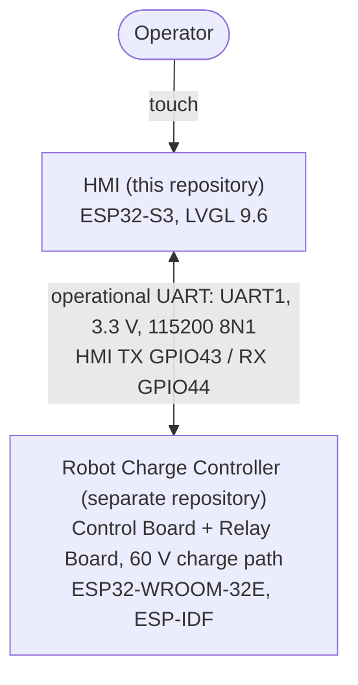

# Project overview

This page explains what the HMI is, what it is not, and where it sits in the Robot Charge Controller (RCC) system. Read it first.

> **Status:** development prototype. Statements about what is implemented do not establish hardware acceptance. For what has actually been checked, see [verification-status.md](../08-status/verification-status.md).

## What the HMI is

A touchscreen operator panel for the Robot Charge Controller. It runs on an **Elecrow DLE06235B / ES3C35P** (ESP32-S3, 480 × 320 landscape LCD with capacitive touch) and talks to the controller over a UART.

It lets an operator:

- watch live charging state, voltage, current and power;
- see measurement validity, faults and inhibit reasons;
- review the current session and the controller event log;
- request **START** and **STOP**;
- change local display settings, join Wi-Fi and update the HMI firmware over the web (OTA).

## What the HMI is not

| The HMI does not... | Because |
|---|---|
| decide whether charging may start, or open/close the relay | The controller owns charging decisions, interlocks and relay control |
| replace the controller's protection logic | Protection lives in the controller firmware and hardware |
| replace a hardware emergency stop | A touchscreen request is not a safety function |
| confirm the physical relay contact position | The relay *command* state is reported, not the contact state |

Control rules the UI must respect (details in [operator-safety-behavior.md](../05-ui/operator-safety-behavior.md)):

- The controller selects one **active control interface**. Being able to *read* status does not imply authority to START/STOP.
- `ACCEPTED` does not mean charging has started.
- A timeout means the outcome is **not confirmed**.
- Loss of communication does not automatically stop charging.

## Where it sits in the system

- The HMI connects to the controller's **operational UART**. The controller also has CAN, RS485 and a service UART; the HMI does not use them.
- The controller lives in a **separate repository**, a sibling directory of this one in the workspace (`../Robot_Charge_Controller/`). Its firmware documents (`docs/firmware/`: ICD, FDD, interface notes) are the normative source for the protocol. This repository's protocol pages must defer to them where they differ.
- The HMI has its own firmware, version, build and OTA path, independent of the controller image.

## Hardware and software baseline

| Item | Value | Source |
|---|---|---|
| Board | Elecrow DLE06235B / ES3C35P, ESP32-S3 | [`README.md`](../../README.md) |
| Display | ST77922 QSPI, native 320 × 480, shown as 480 × 320 landscape | `README.md` |
| Memory | 16 MB flash, 8 MB PSRAM | `README.md` |
| Framework | ESP-IDF 6.1.0, built with `idf.py` (no PlatformIO) | `firmware/CMakeLists.txt` |
| UI library | LVGL 9.6.0 | `lvgl_ui/project.xml`, `README.md` |
| UI authoring | LVGL Pro Editor project in `lvgl_ui/` | see [lvgl-pro-workflow.md](../05-ui/lvgl-pro-workflow.md) |
| Controller link | UART1, 115200 8N1, 3.3 V logic, no flow control | `firmware/components/common/hmi_common` (`hmi_config.h`) |

## The five pages

| Page | Purpose |
|---|---|
| Overview | Charging state, stage strip, link freshness, voltage/current/power, START/STOP |
| Measure | Raw and filtered measurements, validity bits, sample age |
| Faults | Primary fault, active fault mask, inhibit reasons |
| Session | Session information, last command result, recent events |
| Device | Controller identity, build flags, link diagnostics; **Settings** tab (display, language) and Wi-Fi |

Full description: [ui-pages-and-states.md](../05-ui/ui-pages-and-states.md). Visual reference: [mockups/hmi-ui-landscape.html](../mockups/hmi-ui-landscape.html).

## Known limitations worth knowing up front

- The **language** setting is stored, but main UI labels are English only.
- Wi-Fi and OTA exist, but their acceptance on hardware is not recorded.
- The restructured firmware image (ESP-IDF layout + LVGL Pro UI) **has not been flashed to a board** according to the repository's own records.

## Where to go next

| You want to... | Read |
|---|---|
| Find your way around the repository | [repository-map.md](../02-architecture/repository-map.md) |
| Look up a term | [glossary.md](glossary.md) |
| Change how a screen looks | [lvgl-pro-workflow.md](../05-ui/lvgl-pro-workflow.md) |
| Understand layers, start-up and tasks | [firmware-architecture.md](../02-architecture/firmware-architecture.md), [data-flow.md](../02-architecture/data-flow.md) |
| Know what is proven and what is not | [verification-status.md](../08-status/verification-status.md) |
