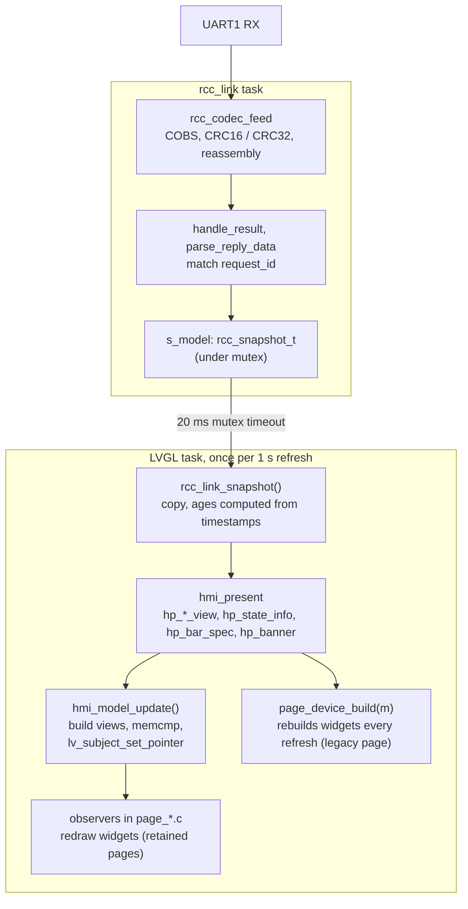
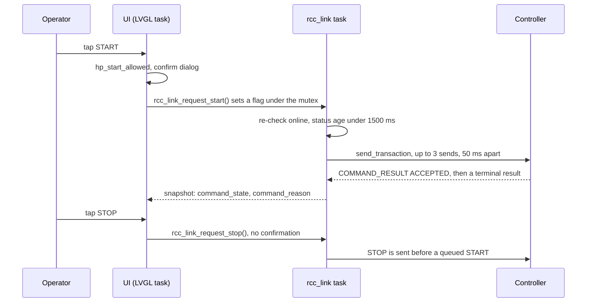

# Data flow: controller to screen

How a byte from the controller becomes a pixel, and how a tap becomes a byte. Read it to know **where to change things** when a controller field is added or a screen value looks wrong.

Built on 2026-11-27 from the source at commit `f96b6bb` (`rcc_link.c`, `rcc_codec.h`, `rcc_types.h`, `hmi_present.h/.c`, `hmi_model.c`, `hmi_shell.c`, `page_*.c`). Not observed on a running target.

## 1. The two paths

Receive path (controller to screen):

Send path (tap to controller):

Threads and locks: [firmware-architecture §4](firmware-architecture.md#4-tasks-locks-and-timing).

## 2. Controller data contract: `rcc_snapshot_t`

Defined in `firmware/components/common/hmi_common/include/rcc_types.h`. It is the **only** controller data the UI may see (pages never call `rcc_link_*` directly except through the shell). Pure C, no ESP-IDF headers, so host tests include it.

Which command fills which fields (`rcc_link.c: parse_reply_data`, `set_header`, `parse_events`):

| Command | Snapshot fields set |
|---|---|
| Any `COMMAND_RESULT` header (every reply, 12 bytes) | `top_state`, `operational_state`, `primary_fault`, `inhibit_mask`; `online`, reply age |
| `GET_DEVICE_INFO` (40 B, product 1, protocol 1) | `product_id`, `protocol_version`, `build_flags`, `hardware_revision`, `firmware_revision`, `image_id`, `boot_id`, `running_links`, `device_valid` |
| `GET_STATUS` (48 B) | `boot_id`, `active_fault_mask`, `relay_command`, `relay_feedback`, `charging_established`, `simulated_measurements`, `simulated_ready`, `is_control` (bit5), `control_interface` (byte 19), `session_id`, `status_valid`, status age |
| `GET_MEASUREMENTS` (32 B) | `measurement_sequence`, `measurement_sample_age_ms`, `vout_mv`, `iout_ma` (signed), filtered values, `vout_status`, `iout_status`, `measurement_valid` |
| `GET_FAULTS` (12 B) | `active_fault_mask`, `inhibit_mask`, `primary_fault`, `faults_valid` |
| `GET_EVENT_LOG` | event ring (8 slots: code, sequence, µs, 4 argument words), `event_missed`; `end_valid`, `end_reason`, `end_session_id`, `end_duration_ms` from `SESSION_COMPLETED` / `SESSION_ABORTED` |
| START / STOP transactions | `last_command`, `command_state`, `command_reason`, command age |
| Link counters | `rx_bad_frames`, `timeouts` |

Only a `COMPLETED` result updates the data fields; `ACCEPTED`, `REJECTED` and `FAILED` replies still refresh the header fields. A reply whose length does not match the expected size is ignored.

Ages (`reply_age_ms`, `status_age_ms`, `measurement_age_ms`, `faults_age_ms`, `command_age_ms`) are computed **when the snapshot is copied**, from monotonic timestamps held in `rcc_link.c`; they are not sent by the controller.

A controller restart is detected by a changed `boot_id` in `GET_DEVICE_INFO` or `GET_STATUS`: cached validity flags and the event ring are cleared and pending START/STOP become UNCONFIRMED.

## 3. From snapshot to views

`hmi_present` (`ui_present`) turns a snapshot into text, tones and small plain-data views. It has no LVGL dependency and is unit-tested (`test/host/test_hmi_present.c`, 308 checks passing on 2026-11-27 after the G2 change).

| Function family | Produces |
|---|---|
| `hp_fresh`, `hp_v_valid`, `hp_i_valid`, `hp_meas_stale`, `hp_in_session`, `hp_fault_state` | Derived booleans and the fault classification used everywhere |
| `hp_state_info`, `hp_hero_view`, `hp_sys_view`, `hp_tel_views`, `hp_gauge` | Overview |
| `hp_chan_view`, `hp_adc_view` | Measure |
| `hp_fault_sum_view`, `hp_fault_pri_view`, `hp_mask_*` | Faults |
| `hp_sess_view`, `hp_events_*`, `hp_event_*` | Session |
| `hp_bar_spec`, `hp_banner`, `hp_start_allowed`, `hp_no_authority`, `hp_start_block` | Action bar, banner, START gating |
| `hp_fmt_*` | Formatting (age, milli-units, duration, since-boot) |

Rules: logic lives here, not in pages. Views are **zero-padded** structs so equal data is byte-equal. Pages map a tone to a colour through `hmi_theme_present.h` and never contain hex colours.

**Retained pages.** `hmi_model.c` owns one pointer subject per view (`hm_chan_v`, `hm_chan_i`, `hm_adc`, `hm_hero`, `hm_sys`, `hm_tel[3]`, `hm_fault_sum`, `hm_fault_pri`, `hm_sess`). `hmi_model_update()` builds the views from the snapshot and `memcmp`s each against the current one; only a changed view triggers `lv_subject_set_pointer`, which wakes the observers bound in `enter()`. Views are static, with no heap.

**Regions no subject drives** (the variable-length fault lists and the event rows) are handled in `update()` with a signature (`hp_events_sig`) so only a changed region is rebuilt.

**Legacy page.** `page_device_build` reads the snapshot (and the settings, Wi-Fi and OTA services) directly and rebuilds all widgets each refresh.

## 4. Polling and freshness

Query scheduling (`rcc_link.c: send_next_query`):

- One query transaction at a time; starts at least **170 ms** apart.
- Nine-step cycle: `PING, STATUS, MEASUREMENTS, STATUS, FAULTS, EVENTS, STATUS, MEASUREMENTS, DEVICE_INFO`. Status is read three times per cycle, measurements twice, faults, events and device info once.
- `GET_EVENT_LOG` carries the saved cursor and `max_count = 4`.
- Actual rate depends on reply time and retries, not on which page is open.

Retries and timeouts: [operator-safety-behavior §4](../05-ui/operator-safety-behavior.md#retries-and-timeouts-rcc_linkc) and [framing-and-transport §3](../04-controller-protocol/framing-and-transport.md#3-timing-retry-and-duplicate-handling).

Freshness thresholds (all in `hmi_present.c` unless noted):

| Predicate | Rule |
|---|---|
| Online | A matching reply within **2 s** (`rcc_link.c`) |
| Status fresh (`hp_fresh`) | online, `status_valid`, status age **< 1500 ms** |
| Voltage / current valid | online, measurement valid, age **≤ 1500 ms**, status bits `& 0x3F == 0x3F` |
| START admission in `rcc_link` | online, status valid, status age **< 1500 ms**, plus simulated-ready rule |

Controller sample age (`measurement_sample_age_ms`) is shown separately and is **not** added to the HMI's held age.

## 5. Send path details

- UI calls `rcc_link_request_start()` / `rcc_link_request_stop()`. Both are non-blocking: they take the model mutex for at most 20 ms and set a flag, returning `false` if refused.
- The link task, on its next loop (about every 10 ms, bounded by the UART read timeout), starts the transaction. STOP is checked first, so it goes before a queued START.
- `rcc_codec_request` builds one SINGLE frame (≤ 145 wire bytes, no allocation).
- The request id starts from `esp_random()` so a quick HMI reboot does not reuse ids the controller still retains.

## 6. Adding a controller field: where it goes

Same six steps as `firmware/components/README.md`, with the reason for each:

| Step | Where | Why there |
|---|---|---|
| 1 | `rcc_codec` | Only if the wire format changed; keep it pure and add a vector to `test_rcc_codec.c` |
| 2 | `rcc_link.c: parse_reply_data` | The one place that reads bytes; copy under the model mutex |
| 3 | `rcc_types.h` | The contract between link and UI |
| 4 | `hmi_present` | Text, tone and view; add a host test |
| 5 | `hmi_model.c` | Only for a new retained-page view: field in `views_t`, line in `fill()`, row in `tbl[]`, extern in `hmi_model.h` |
| 6 | `pages/page_*.c` | Create the widget in `enter`, set it from the view in the observer. Layout itself is in `lvgl_ui` ([lvgl-pro-workflow](../05-ui/lvgl-pro-workflow.md)) |

Then give the desktop simulator data in `firmware/tools/sim/sim_scenarios.c` and the controller simulator the field in `firmware/tools/controller_sim.py`, and update the [protocol pages](../04-controller-protocol/commands-and-payloads.md).

## 7. Failure modes in this path

| Failure | What the HMI does |
|---|---|
| CRC error, bad frame | Frame dropped, `rx_bad_frames` counted; no state change |
| Partial multi-frame object | Reset after 2 s without a frame |
| Reply with unexpected length | Ignored |
| Snapshot mutex not obtained within 20 ms | `rcc_link_snapshot` returns an **all-zero** snapshot, which the UI reads as offline/unknown (*inferred* from `memset` before the lock; not observed) |
| Controller restart | See §2 |
| No reply for 2 s | `online = false`; see [operator-safety-behavior §6](../05-ui/operator-safety-behavior.md#6-link-loss-and-stale-data) |
