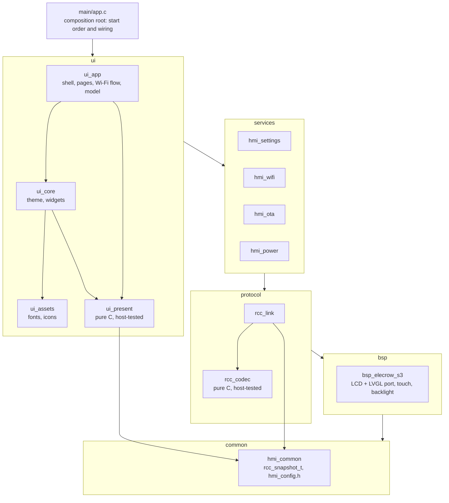
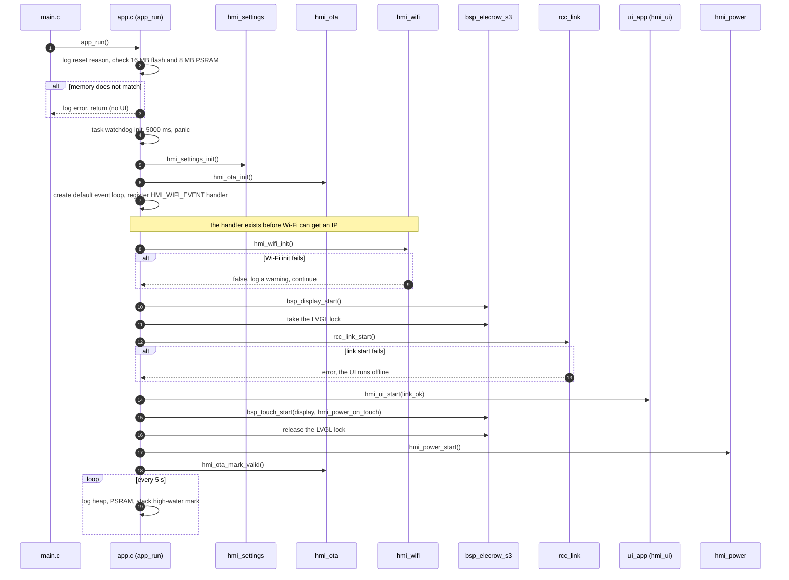

# Firmware architecture

Layers, dependency rules, start-up order, tasks and locks of the HMI firmware. The binding rules and step-by-step recipes stay in [`firmware/components/README.md`](../../firmware/components/README.md) and [`firmware/components/ui/README.md`](../../firmware/components/ui/README.md); this page is the overview and the place for the facts they do not state (tasks, timing, memory).

Built on 2026-11-27 from commit `f96b6bb` (`main/app.c`, component `CMakeLists.txt` files, `rcc_link.c`, `hmi_shell.c`, `hmi_ota.c`, `sdkconfig.defaults`). The decision record is [ADR-0001](../09-decisions/0001-esp-idf-component-layout.md). Nothing here was measured on a target.

## 1. Layers

Arrows mean "may depend on". Dependencies point down only; a layer may skip the one below (`ui_app` uses `rcc_link`, `hmi_power` uses `bsp_elecrow_s3`). The full per-component table is in `firmware/components/README.md`.

| Layer | Components | Role |
|---|---|---|
| `common` | `hmi_common` | The controller data contract (`rcc_types.h`) and board constants (`hmi_config.h`) |
| `bsp` | `bsp_elecrow_s3` | ST77922 QSPI LCD, LVGL port, touch, LEDC backlight. Pins in `src/bsp_pins.h`. Depends on no project component |
| `protocol` | `rcc_codec`, `rcc_link` | Frame codec; UART1 task, snapshot, START/STOP |
| `services` | `hmi_settings`, `hmi_wifi`, `hmi_ota`, `hmi_power` | NVS settings; Wi-Fi station; Web OTA; brightness and dim policy |
| `ui` | `ui_assets`, `ui_present`, `ui_core`, `ui_app` | Fonts/icons; presentation logic; theme and widgets; shell, pages, Wi-Fi flow, retained-mode model |

## 2. Dependency rules (enforced by the build)

Dependencies point **down only**. They are the `REQUIRES` / `PRIV_REQUIRES` of each `CMakeLists.txt`, so an include across a layer in the wrong direction fails the build. Full table: `firmware/components/README.md`. In short:

1. **Services do not call each other.** The one exception is `hmi_power → hmi_settings`. Reactions between services go through `esp_event` and `app.c`: `HMI_WIFI_EVENT_CONNECTED` / `_LINK_LOST` start and stop the OTA server (`app.c: on_wifi_link`).
2. **The BSP calls nothing above it.** Policy arrives as a callback: `bsp_touch_start(display, hmi_power_on_touch)`.
3. **The UI does not use the BSP.** Board constants the Device page shows are in `hmi_config.h`.
4. **`rcc_snapshot_t` is the only controller data the UI sees.**
5. **No runtime indirection for a single implementation.** Plain C functions; the simulator and host tests substitute modules at link time (`tools/sim/sim_stubs.c`).
6. Prefer `PRIV_REQUIRES`. Project components compile with `-Wall -Wextra -Werror`.

How the generated LVGL Pro layouts fit: `ui_app` additionally compiles `lvgl_ui/components/hmi/*/*_gen.c` ([repository-map](repository-map.md), [lvgl-pro-workflow](../05-ui/lvgl-pro-workflow.md)). These sources are not a layer of their own and are built with the shim `hmi_lvgl_export.h`.

## 3. Start-up order

`firmware/main/main.c` calls `app_run()` in `app.c`:

| # | Stage | Detail |
|---|---|---|
| 1 | Boot report | Reset reason, IDF version, flash and PSRAM size. **Aborts** (returns) unless flash is exactly 16 MB and PSRAM is initialised and exactly 8 MB |
| 2 | Task watchdog | `esp_task_wdt_init` with `HMI_TWDT_TIMEOUT_MS` = 5000 ms, panic on trigger |
| 3 | Services | `hmi_settings_init()` (NVS) → `hmi_ota_init()` → default event loop → register `HMI_WIFI_EVENT` handler → `hmi_wifi_init()` (failure logged, start-up continues) |
| 4 | Board and UI | `bsp_display_start()` → take the LVGL lock → `rcc_link_start()` (failure logged; UI runs offline) → `hmi_ui_start(link_ok)` → `bsp_touch_start(display, hmi_power_on_touch)` → invalidate → unlock → `hmi_power_start()` |
| 5 | Confirm image | `hmi_ota_mark_valid()` cancels rollback. Reached after the UI is up, **before** any controller communication is proven |
| 6 | Alive loop | Every 5 s logs free internal heap, free PSRAM and the main-task stack high-water mark |

The OTA handler is registered before `hmi_wifi_init()` so the first `CONNECTED` event cannot be missed.

## 4. Tasks, locks and timing

Only facts visible in the source. Priorities and stack sizes not set by this repository come from ESP-IDF or library defaults and are **not** stated here. No stack, latency or CPU measurement has been recorded ([verification-status](../08-status/verification-status.md)). Stack sizes passed to `xTaskCreate` are **bytes** in ESP-IDF.

| Task / context | Created by | What it does | Notable values |
|---|---|---|---|
| `main` (app_main) | ESP-IDF | `app_run()`; then the 5 s alive log | Not subscribed to the TWDT |
| `rcc_link` | `rcc_link_start` (`xTaskCreate`) | UART read (10 ms timeout), codec, transaction timers, query scheduler, sends START/STOP | stack 6144 B, priority 5; subscribes to the TWDT and resets it each loop |
| LVGL port task | `esp_lvgl_port` (`ESP_LVGL_PORT_INIT_CONFIG()` defaults) | Runs LVGL, including the 1 s `refresh` timer and all UI callbacks | Subscribes to the TWDT on the first refresh and feeds it from the refresh, so a stalled refresh for 5 s triggers a panic |
| `sys_evt` (event loop) | ESP-IDF | Runs `on_wifi_link`, which starts/stops the OTA HTTP server | |
| HTTP server task | `httpd_start` in `hmi_ota` | Web OTA upload on port 80 | |
| `ota_reboot` | `hmi_ota` (`xTaskCreate`) | Delayed restart after a successful OTA | stack 3072 B, priority 5 |
| Wi-Fi / lwIP | ESP-IDF | Station | |

Locks and shared state:

| Shared object | Guard | Who touches it |
|---|---|---|
| `s_model` (`rcc_snapshot_t`) and transactions in `rcc_link.c` | FreeRTOS mutex `s_model_lock` | `rcc_link` task (writer); LVGL task via `rcc_link_snapshot` (copy, **20 ms** timeout) and `rcc_link_request_*` (20 ms timeout) |
| All LVGL objects | `esp_lvgl_port` lock | Everything that creates or changes widgets must hold it. `app.c` takes it around `rcc_link_start`, `hmi_ui_start`, `bsp_touch_start`; callbacks run inside the LVGL task |
| Settings blob | `hmi_settings` internal | UI callbacks, `hmi_power` |

Memory:

- 16 MB flash, 8 MB octal PSRAM at 80 MHz (`sdkconfig.defaults`).
- `CONFIG_LV_MEM_SIZE=131072` (128 KB LVGL heap). The retained-mode design exists partly to avoid rebuilding widgets, and the restructure design set a rule of **no new dynamic allocation** on the UI path.
- Views and the model are static; no heap.
- `CONFIG_LV_USE_OBJ_NAME=y` is required by the layout export (name lookup).

Rule from ADR-0001: every UI call into a service runs under the LVGL lock and must not block.

## 5. Dependencies and versions

Pinned in `firmware/dependencies.lock`: lvgl `9.6.0~1`, `esp_lvgl_port` `2.9.0`, `esp_lcd_st77922` `2.1.1`. ESP-IDF **6.1.0**.

## 6. Test seams

| Seam | How |
|---|---|
| `rcc_codec`, `hmi_present` | Pure C, built by `test/host/run.sh` with a stub directory (`test/host/stubs`) |
| `rcc_link` | `test_rcc_link.c` includes the source and stubs the ESP-IDF calls |
| UI | `tools/sim`: real UI components with LVGL on a PC, link-time stubs for the link and services |
| Whole link | `tools/controller_sim.py` over a USB-UART adapter, and its 33 tests |

## 7. Open points

- Task priorities, stack headroom and the refresh/UART load have **not** been measured on hardware. Do not change `rcc_link` stack or priority, the TWDT timeout or LVGL heap size without a recorded measurement; the controller project applies the same rule to its own budgets.
- `hmi_ota_mark_valid()` confirms an image before link health is known (see [settings-wifi-ota](../06-services/settings-wifi-ota.md)).
- The LVGL port task priority and stack come from library defaults; record the real values from a run when the image is first flashed.
