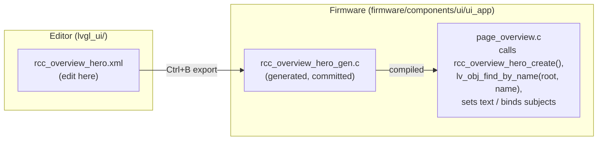

# LVGL Pro workflow

How to change the look of the HMI screens. `lvgl_ui/HMI.md` and `lvgl_ui/README.md` are now short pointers to this page.

Checked against commit `f96b6bb` by reading the source. The Editor steps themselves were not re-run.

## The model in one paragraph

The screens are drawn as **layout components** in the LVGL Pro Editor (`lvgl_ui/components/hmi/rcc_*`). The Editor exports each one as C (`*_gen.c/.h`), which is committed. The firmware compiles those generated files and calls their `rcc_*_create()` functions from hand-written code (`hmi_shell.c`, `pages/page_*.c`). The hand-written code then finds named widgets inside the created tree and fills them with live data. **Layout belongs to the Editor; data, behaviour and callbacks belong to the firmware.**



## What is compiled and what is only a preview

| Content | Compiled into the device? | Purpose |
|---|---|---|
| `lvgl_ui/components/hmi/*/*_gen.c` | **Yes** | The production layouts |
| `lvgl_ui/screens/hmi_*` | No | Full-screen previews with sample data, so you can see a state in the Editor |
| `lvgl_ui/lvgl_ui.c`, `lvgl_ui_gen.c`, `file_list_gen.cmake`, `CMakeLists.txt` | No | Editor's own aggregate project and simulator |
| `lvgl_ui/fonts`, `lvgl_ui/images` | No (as files) | Editor assets for previews. Firmware fonts and icons come from `ui_assets` |

The rule is in `firmware/components/ui/ui_app/CMakeLists.txt`: it globs only `lvgl_ui/components/hmi/*/*_gen.c` and adds each directory to the private include path.

Because production fonts and icons come from `ui_assets`, a font or image changed only inside `lvgl_ui/` will **not** change the device unless `ui_assets` is updated too.

## Preview screens in the Editor

`lvgl_ui/screens/` holds full-screen previews built from the layout components, with sample data (not compiled into the firmware):

| Content | XML files |
|---|---|
| The five main pages | `hmi_overview`, `hmi_measure`, `hmi_faults`, `hmi_session`, `hmi_device` |
| HMI state variants | suffixes `_idle`, `_precheck`, `_inhibited`, `_fault`, `_offline`, `_remote`; pages without a suffix use CHARGING data |
| Device tabs | `hmi_device_link`, `hmi_device_settings` |
| Confirmation and command results | `hmi_confirm`, `hmi_command_*` |
| Wi-Fi and keyboard | `hmi_wifi_*` |
| OTA progress | `hmi_ota_*` |

In Preview mode the navigation rail switches between the five pages. The START flow can be tried from `hmi_overview_idle` and the Wi-Fi flow from `hmi_device_settings`; open the other result states directly from the XML list. Select a region, button, label or icon on its own to edit it in Design mode or XML.

## Prerequisites

- LVGL Pro Editor (the project declares LVGL 9.6.0, 480 × 320).
- ESP-IDF 6.1.0 environment for building (see the build guide, planned in `07-development/`).
- `firmware/sdkconfig.defaults` already sets `CONFIG_LV_USE_OBJ_NAME=y` and `CONFIG_LV_MEM_SIZE=131072`. If you have an older generated `firmware/sdkconfig`, update both through `idf.py menuconfig` (or regenerate it), otherwise name lookups and the LVGL heap budget will differ.

## Change a layout

1. Open the **`lvgl_ui`** folder in the LVGL Pro Editor.
2. Open the component to change, under `components/hmi/`. Component groups match the UI areas:

   | Prefix | Area |
   |---|---|
   | `rcc_shell_*` | Rail, header, banner, action bar, confirm modal, overlay, OTA and no-authority notices |
   | `rcc_overview_*` | Overview page |
   | `rcc_measure_*` | Measure page |
   | `rcc_faults_*` | Faults page |
   | `rcc_session_*` | Session page |
   | `rcc_device_*` | Device page and tabs |
   | `rcc_wifi_*` | Wi-Fi busy/fail states |
   | `rcc_telemetry_card` | The voltage/current/power card, reused |

3. Edit the layout (Design mode or XML). **Keep existing widget names.** See [Widget names are the contract](#widget-names-are-the-contract).
4. Press **Ctrl+B** to export. The `*_gen.c/.h` next to the XML are rewritten.
5. Build from an ESP-IDF shell (not Git Bash, where `idf.py` silently does nothing because `MSYSTEM` is set):

   ```sh
   cd firmware
   idf.py build
   ```

   The project compiles with `-Wall -Wextra -Werror` for hand-written code. The generated layout sources emit LVGL deprecation warnings (recorded in the status page).
6. Run the regression checks (see [Verify the change](#verify-the-change)).
7. Commit the `.xml` **and** the regenerated `_gen.c/.h` together. Never commit one without the other.

## Widget names are the contract

The firmware locates widgets by name, for example:

```c
lv_obj_find_by_name(modal, "confirm_cancel");
lv_obj_find_by_name(b, "action_label");
```

(`hmi_shell.c`; the helper `hmi_data_widget()` in `hmi_data_widgets.h` wraps this and asserts the widget exists.)

- Renaming or deleting a named widget breaks the binding. A missing name hits `LV_ASSERT_MSG` on the device rather than failing the build.
- Names that the Editor generates automatically contain `#`. The firmware's export shim discards those on purpose, so only **explicit names** are visible at runtime.
- Before renaming, search the firmware: `grep -rn '"old_name"' firmware/components/ui`.
- If a rename is needed, change the Editor name and the `page_*.c`/`hmi_shell.c` lookup in the same commit.

## The export shim

Generated layout sources are compiled with `-include firmware/components/ui/ui_app/src/hmi_lvgl_export.h`. It:

- disables the Editor's aggregate header (`LVGL_PRO_LVGL_UI_H`) and compile-target checks, so only the layout is used;
- wraps `lv_obj_set_name` so automatic instance names (containing `#`) are dropped and only explicit names remain on the device.

You normally do not edit this file. If an Editor upgrade changes the generated API, this is the place that will need adjusting.

## Add a new layout component

1. Create the component in the Editor under `components/hmi/`, name it `rcc_<area>_<thing>`, and export.
2. Use it from hand-written code: include its `_gen.h` and call `<name>_create(...)`.
3. The CMake glob picks up `*_gen.c` automatically, but a plain `file(GLOB)` does not re-scan on its own. Re-run CMake (for example touch `firmware/components/ui/ui_app/CMakeLists.txt`) after adding a file. *(Inferred from the glob and the comment on the page glob in that file; confirm on your machine.)*

## Verify the change

| Check | Command (from `firmware/`) | Passing result |
|---|---|---|
| Firmware builds | `idf.py build` | Build succeeds |
| Presentation logic | `CC=gcc sh test/host/run.sh` | `ALL PASSED`, `test_hmi_present: 308 checks, 0 failed` |
| Desktop render regression | `sh tools/sim/check.sh` (after `check.sh baseline` once on a reference commit) | `PIXEL DIFF: none`, `MORPH DIFF: none` |
| On the board | `idf.py -p <PORT> flash monitor` | Visual and touch check of the changed screen |

Caveat: the pixel baseline was recorded **before** the LVGL Pro migration. A layout change made in the Editor is *expected* to differ; re-record the baseline deliberately and review the images rather than ignoring the diff. The last recorded comparison after migration showed 77 of 80 images identical (the Wi-Fi scrollbar and spinner differ) — see [verification-status.md](../08-status/verification-status.md).

## Editor-only output

Gitignored and safe to delete: `lvgl_ui/preview-build/`, `lvgl_ui/preview-bin/`, `lvgl_ui/build/`, `lvgl_ui/.cache.json`.

## Common mistakes

| Mistake | Effect | Prevention |
|---|---|---|
| Hand-editing a `*_gen.c` | Overwritten by the next export | Edit the XML in the Editor |
| Committing XML without regenerated C (or reverse) | Firmware differs from the design | Commit both |
| Renaming a widget | Assert on device when the page opens | Search `ui_app` first; change both sides together |
| Editing only `lvgl_ui/fonts` or `images` | No effect on device | Update `ui_assets` (see `firmware/components/ui/ui_assets/src/fonts/README.md`, `firmware/tools/gen_icons.py`) |
| Running `idf.py` from Git Bash | Silently does nothing | Use the ESP-IDF PowerShell/cmd shell or the dev container |
| Treating `lvgl_ui/screens/` as production | They carry sample data and are not compiled | Production layouts are in `components/hmi/` |
