# Operator and safety behaviour

What the HMI promises the operator, what it must never imply, and how START, STOP, authority and loss of link are actually implemented. Read this before changing anything on the action bar, the banner, `hmi_present.c` gating, or `rcc_link` command handling.

> **Prototype.** This HMI is not safety-validated and is not a safety function. A touchscreen STOP is a *request* to the controller. It does not replace the controller's protection logic or a hardware emergency stop, and it has never been exercised on a charging session ([verification-status](../08-status/verification-status.md)). The controller project, not this page, owns safety claims.

Checked on 2026-11-27 against HMI commit `f96b6bb` (`rcc_link.c`, `hmi_present.c`, `hmi_shell.c`, `page_device.c`, `hmi_power.c`) and the controller documents in `../Robot_Charge_Controller/docs/firmware/` (ICD §8, §10, §19; FDD-006; FDD-011 §1.2; `firmware-open-work.md` B6). Statements about code are `confirmed` (read in source). Items marked *inferred* are conclusions drawn from the code, not observed on a device.

## 1. Ownership

| Decision | Owner | HMI role |
|---|---|---|
| Whether charging may start; relay close/open; interlocks; fault latching | **Controller** (`ControlSafetyTask` is the only relay owner, per the controller firmware rules) | Send START/STOP requests; display what the controller reports |
| Who may command | Controller CONFIG (`operational_interface`, `operational_node`) | Display `control_interface` / `requester_is_control`; learn denial from `UNAUTHORIZED_SOURCE` |
| Whether a command succeeded | Controller result (`COMMAND_RESULT`) | Show it separately from charging state |
| Contact position | Nobody: the board has no contact feedback | Never claim contacts opened or closed |

The owner decided on 2026-11-20 that, for the demo, the HMI is the START/STOP issuer on the operational UART, node 0 (controller `DEMO1-CTRL`, CONFIG generation 2). The same record states that a START reaching `CHARGING` is **not verified**.

## 2. Rules the UI must respect

| # | Rule | Source | Where the HMI implements it |
|---|---|---|---|
| R1 | Monitoring access does not imply START/STOP authority | ICD §10 | Reads are always sent; START/STOP results decide authority display ([§5](#5-authority)) |
| R2 | `ACCEPTED` is not "charging started" | ICD §8.2, §11.2 | `RCC_COMMAND_ACCEPTED` shows "Request accepted — checking"; state and result are separate |
| R3 | A timeout means the outcome is **unknown**, not failed | ICD §8 | `RCC_COMMAND_UNCONFIRMED`, shown as "NOT CONFIRMED" |
| R4 | Loss of communication does not stop charging | ICD §19 | Banner `LINK LOST · CHARGING MAY CONTINUE` |
| R5 | Relay command is not contact position | controller FDD-011 evidence rule | Wording "Relay commanded open/closed"; Overview row "Relay" shows the command |
| R6 | Never present stale data as current | HMI design | `hp_fresh()`: online, status valid, status age < 1500 ms; otherwise state is `UNKNOWN / STATE NOT CONFIRMED` |
| R7 | A value is usable only when all six channel-status bits are set | ICD §11 | `hp_v_valid()` / `hp_i_valid()` require `(status & 0x3F) == 0x3F` and measurement age ≤ 1500 ms |
| R8 | Unknown fault/inhibit bits are shown raw, never dropped | CR-02 | `hp_mask_text()` prints `bit N` past the known names |
| R9 | Simulated data is always labelled | controller demo proposal | `SIMULATED V/I` banner and START dialog when GET_STATUS flag bit3 is set |

## 3. START

Four independent checks stand between a tap and the relay. Only the last belongs to the controller.

| Step | Check | Code |
|---|---|---|
| 1. Offer | START button is shown only if `hp_start_allowed()`: fresh status; if simulated V/I then `simulated_ready`; no command SENDING or ACCEPTED; and state is `INHIBITED` or `OPERATIONAL/IDLE` | `hmi_present.c: hp_start_allowed` |
| 2. Confirm | Tap opens "Confirm Charge Start" (or "Start with SIMULATED V/I"). It shows controller state, link age, ADC validity, fault/inhibit. **SEND START** queues the request | `hmi_shell.c: open_modal`, `send_start_click` |
| 3. Admit | `rcc_link_request_start()` re-checks at send time: online, status valid and < 1500 ms old, simulated-ready, no START/STOP already active or queued | `rcc_link.c: rcc_link_request_start` |
| 4. Controller | Controller authorises, prechecks and decides. The dialog footnote says so: "Controller validates VREQ & precheck before closing relay" | controller ICD §11.2 |

START is **not** offered in `VREQ_VALIDATE` or `PRECHECK`, though the controller can accept a START from those states. This is deliberate narrowing (`hp_start_allowed` accepts only `INHIBITED` and `OPERATIONAL/IDLE`). Host tests cover the gating (`test_hmi_present.c`, `test_rcc_link.c`).

When START is blocked the Overview STOP bar shows `Start blocked: UART link stale` or `Start blocked: latched fault active` (`hp_start_block`). Other reasons for not offering START give no explanation.

### Command life cycle in the HMI

The states below are `rcc_command_state_t` in `rcc_types.h`, set by `rcc_link.c`. They describe the **request** the HMI sent, not the charging state.

```mermaid
stateDiagram-v2
    [*] --> NONE
    NONE --> SENDING: request START or STOP accepted by rcc_link
    COMPLETED --> SENDING: next request
    REJECTED --> SENDING: next request
    FAILED --> SENDING: next request
    UNCONFIRMED --> SENDING: next request
    SENDING --> ACCEPTED: result ACCEPTED, retries stop
    SENDING --> COMPLETED: terminal result COMPLETED
    SENDING --> REJECTED: terminal result REJECTED
    SENDING --> FAILED: terminal result FAILED
    SENDING --> UNCONFIRMED: no reply after 3 sends, or UART write failed
    ACCEPTED --> COMPLETED: terminal result COMPLETED
    ACCEPTED --> FAILED: terminal result FAILED
    ACCEPTED --> UNCONFIRMED: no terminal result within 15 s
    SENDING --> UNCONFIRMED: controller restart detected
    ACCEPTED --> UNCONFIRMED: controller restart detected
```

Notes: per the controller ICD an `ACCEPTED` command receives exactly one terminal result, `COMPLETED` or `FAILED`; `REJECTED` means it was never admitted. The code does not forbid `ACCEPTED` followed by `REJECTED`, so the display handles it anyway. `UNCONFIRMED` means the outcome is **unknown**, not failed.

### START result display

| Command state | Action-bar text |
|---|---|
| SENDING | "Sending START…" / "Waiting for the controller" |
| ACCEPTED | "Request accepted — checking" / "Accepted, not yet complete" |
| UNCONFIRMED | "NOT CONFIRMED" / "No reply to START" |
| REJECTED, FAILED | "START rejected" / reason name (for example `CHARGER_REQUEST_ABSENT`, `INVALID_STATE`) |
| COMPLETED | Normal bar; the state hero shows `CHARGING` |

`CHARGING` reported by the controller without `charging_established` is shown as `NOT_CONFIRMED` / `CHARGING NOT ESTABLISHED` (`hp_state_info`).

## 4. STOP

- **No confirmation.** STOP is sent immediately.
- **No gating** on link or status freshness: `rcc_link_request_stop()` only refuses if a STOP is already active or queued. It is dispatched before a newly queued START.
- It is a **request**. A tap is not proof the controller received it.

| Command state | Action-bar text |
|---|---|
| SENDING | "Waiting for the controller…" / "STOP sent — not yet confirmed"; button becomes "STOPPING…" |
| COMPLETED | "Stopped by command" / "Relay commanded open" |
| REJECTED | "STOP rejected" / reason name; **except** reason `QUEUE_FULL`: "Stop took effect, not tracked" / "Send STOP again" (G2, below) |
| FAILED | "Stop took effect, not tracked" / "Send STOP again" |
| UNCONFIRMED, other | "NOT CONFIRMED" / "No reply to STOP — check controller" |

Controller semantics for comparison (ICD §11.2 as extracted in [commands-and-payloads §4.3](../04-controller-protocol/commands-and-payloads.md#43-stop_charge)): relay OFF is commanded **before** persistence and before the reply; `FAILED/PERSISTENCE_FAILED` still means relay OFF was commanded; and `REJECTED/QUEUE_FULL` means the STOP **still took effect** but could not be tracked. See G2, which is now handled in the HMI.

### Retries and timeouts (`rcc_link.c`)

- Each transaction is sent up to 3 times in total (two identical retransmissions at 50 ms), same `request_id` and bytes, matching `UART.md` §7.
- After `ACCEPTED` retries stop and the HMI waits up to **15 s** for the terminal result, then shows UNCONFIRMED. That is an HMI limit, not a controller guarantee.
- A changed `boot_id` (controller restart) cancels pending START/STOP as UNCONFIRMED and clears cached events.
- Action-bar feedback for a command stays visible for 15 s after its terminal result.

## 5. Authority

What the HMI knows, and where it shows it:

| Source | Meaning | Where shown |
|---|---|---|
| GET_STATUS byte 19 `control_interface` | Which interface the controller's CONFIG grants (0 NONE, 1 CAN, 2 RS485, 3 UART, 4 SVC) | Device → Controller, last chip: `NONE / CAN / RS485 / UART / SVC` |
| GET_STATUS flag bit5 `requester_is_control` | This HMI's port and node are the control source | Same chip reads `THIS HMI` |
| `REJECTED` with reason `UNAUTHORIZED_SOURCE` (`0x0005`) | A START/STOP was refused for lack of authority | Banner `HMI HAS NO CONTROL AUTHORITY` and a no-authority bar, both for 15 s after the rejection |

Against a controller older than CR-01 both fields are 0, which the chip would show as `NONE`. Treat as *unknown* in that case.

**The HMI does not gate START or STOP on authority.** Whether `is_control` is false does not hide the buttons (see G1). The no-authority indication appears only after a rejected command.

## 6. Link loss and stale data

| Condition | Threshold | Display |
|---|---|---|
| No matching reply | > 2 s | `online = false`; header pill `OFFLINE · <age>`; banner `LINK LOST · CHARGING MAY CONTINUE`; state hero `UNKNOWN / STATE NOT CONFIRMED`; relay row `—` |
| UART failed to initialise | at start-up | Header `UART FAILED`; banner `UART INIT FAILED · NO CONTROLLER LINK`; UI keeps running |
| Status stale | ≥ 1500 ms | START not offered; state unknown |
| Measurement stale or invalid | > 1500 ms or status bits ≠ `0x3F` | Telemetry cards show `STALE DATA` / dash; power is derived only when both V and I are valid |
| VOUT at the measurement floor | status bit6 | Shown as an upper bound (`<=3.4`) |
| Latched fault | `top_state = LATCHED_FAULT` | Banner `NEW FAULT: <name> · TAP TO VIEW`, jumps to Faults |

While the status is stale or the link is offline, the status strip on non-Overview pages shows `UNKNOWN` with "Charging may still be in progress" and a STOP button.

## 7. Behaviour that can surprise an operator

| Behaviour | Detail | Code |
|---|---|---|
| Screen refresh pauses | The 1 s refresh does nothing while a finger is down, a START modal is open, or an overlay (Wi-Fi) is open. Header, banner, state and bar are **frozen** meanwhile. OTA progress still updates | `hmi_shell.c: refresh` |
| STOP is not reachable with a modal or overlay open | `action_click()` returns while the START modal is open; the Wi-Fi overlay covers the page and bar; the OTA progress overlay is moved to the foreground | `hmi_shell.c` |
| Dimming is suppressed only during a session | Backlight dims after the sleep timeout unless `hp_in_session()` (fresh, `OPERATIONAL`, states `VREQ_VALIDATE`…`CHARGING`). A fault, offline link or OTA does not prevent dimming. A touch that only wakes the screen is swallowed | `hmi_shell.c`, `hmi_power.c` |
| OTA can run while charging | The updater has no charging-state gate and reboots the HMI on success | [settings-wifi-ota](../06-services/settings-wifi-ota.md) |
| Language setting does nothing yet | Stored, labels stay English | |
| Event log is short | The HMI keeps the last 8 events; the controller holds 32 and loses them on restart. Session duration comes from `SESSION_COMPLETED/ABORTED` events | `rcc_types.h`, `rcc_link.c` |
| Event times are relative | The HMI never sends `SET_TIME`; times are since controller boot | |

## 8. Simulated measurements mode

Controller GET_STATUS flag bit3 `simulated_measurements` means V/I are synthetic; bit4 `simulated_ready` means the model is producing samples. Legacy controllers leave both 0.

- A two-line banner starts with `SIMULATED V/I | REAL relay cmd, not contacts` on **all five pages**, with `(STALE)` or `(WAIT)` when appropriate, and keeps link/fault warnings as the second line.
- START is offered and admitted only when `simulated_ready` is set.
- The START dialog is titled "Start with SIMULATED V/I" and says the relay command is real.
- Session data is annotated `SIMULATED V/I`.
- Per the controller demo notes the relay actuation and persistence are real, with a 60 s effective in-memory session cap. Simulated current does not establish actual charging.

## 9. Known gaps

Observed while reading the code on 2026-11-27. They are documentation of the current state, **not** approved waivers or accepted risks. Severity here is a suggestion for the human design authority, based on consequence only; none has been assessed by a qualified reviewer.

| ID | Gap | Why it matters | Suggested handling | Status |
|---|---|---|---|---|
| G1 | START/STOP are not gated on `is_control`, `control_interface`, product/protocol compatibility (`hp_fw_compat`) or `relay_enable_authorized`. The data is already in the snapshot and shown on Device | An operator can attempt START that will be rejected; the "no authority" cue arrives only after the attempt | Decide whether to warn or hide START when `status_valid && !is_control` (older controllers report 0, so "unknown" must not hide STOP) | Open, decision needed |
| G2 | STOP `REJECTED/QUEUE_FULL` was shown as "STOP rejected" + `QUEUE_FULL`. The controller (ICD, STOP ledger full) says the STOP **still took effect** (relay OFF, `REMOTE_INHIBIT`) | Wording suggested nothing happened; operator might not realise the relay was commanded off | `hp_bar_spec` now shows "Stop took effect, not tracked" / "Send STOP again" for reason `QUEUE_FULL` on a STOP (the same text as `FAILED`); START + `QUEUE_FULL` stays a rejection. Host test added | **Implemented 2026-11-27, not reviewed, not tested on hardware** |
| G3 | STOP unreachable while the START modal, Wi-Fi overlay or OTA overlay is open; refresh is paused with a modal/overlay/finger down | Earlier design required STOP accessibility through every modal | Allow STOP from the modal, or close overlays on a fault; keep refresh running for header/banner | **Deferred** (owner decision 2026-11-27): any UI change must also change `lvgl_ui`; see [G3 options](#g3-options-recorded-for-later) |
| G4 | START not offered in `VREQ_VALIDATE` / `PRECHECK` and some blocked reasons are silent | Operator sees no START and no reason | Add a reason string, or document as intended | Open, low |
| G5 | `PRODUCT BUILD` label derives only from build-flag bit0 (provisional); `Relay locked` from bit1 not set | Not production certification | Rename or qualify before any release claim | Open, low |
| G6 | No reconnect control; no CRC16/CRC32 counters; no clock sync | Diagnostics only | Optional | Open, low |

Items G1 and G2 touch the action bar and gating (G2 has been changed; it still needs the review below). Per the controller project's rules, a change that affects relay-related operator behaviour needs a recorded review, and a bench result cannot waive a requirement.

### G3 options (recorded for later)

G3 is **deferred**. Two parts: STOP is unreachable behind the START dialog, Wi-Fi overlay and OTA overlay; and the 1 s refresh pauses while a finger is down or a dialog/overlay is open, which freezes header, banner and state. Options discussed on 2026-11-27, none implemented:

| Option | What | Notes |
|---|---|---|
| A | Keep header, banner and action bar refreshing during dialogs, overlays and touch; skip only the page rebuild | Fixes what the operator *sees*; small change in `hmi_shell.c: refresh`; does not make STOP reachable |
| B | Auto-dismiss the START dialog or an overlay and return to Overview when the situation changes (state leaves `IDLE`/`INHIBITED`, latched fault, link loss, session start); decision as a pure `hmi_present` function with a host test | No new control. Which triggers close the Wi-Fi flow, and losing typed input, are open decisions |
| C | A small STOP control that stays on top of every screen, dialog and overlay | Guarantees reachability; needs space in the rail or header, a layout change and a new 80-image baseline; accidental-tap risk |
| D | A STOP button inside the START dialog | Covers only that dialog |
| E | Accept the limitation and document "close the overlay first"; the HMI is not an emergency stop | No code; needs a written acceptance by the human design authority |

Recommendation recorded at the time: **A then B**. Open questions for the owner: which option; whether link loss should auto-close the Wi-Fi flow; whether losing typed Wi-Fi input is acceptable; whether an overlay inactivity timeout is wanted (a value must come from a decision, not be invented).

**Constraint from the owner:** a UI change must be made in both places. The visible layout lives in `lvgl_ui` (LVGL Pro) and the behaviour in `firmware/components/ui`; changing only one leaves the Editor project and the firmware out of step ([lvgl-pro-workflow](lvgl-pro-workflow.md)). Even options that look like pure logic (A, B) may need layout changes in `lvgl_ui` once designed, so G3 waits until that work can be planned as one change.

## 10. Before changing this behaviour

1. Read ICD §8, §10, §11.2, §13, §19 and the extract in [commands-and-payloads](../04-controller-protocol/commands-and-payloads.md).
2. Put logic in `hmi_present` with a host test; keep `rcc_link` gating and UI gating consistent (UI is advisory, `rcc_link` and the controller are the real gates).
3. Run `CC=gcc sh test/host/run.sh` and the controller simulator scenarios (`authority deny`, `link silence`, `fault overcurrent`).
4. Update the table above and [verification-status](../08-status/verification-status.md) in the same change.
