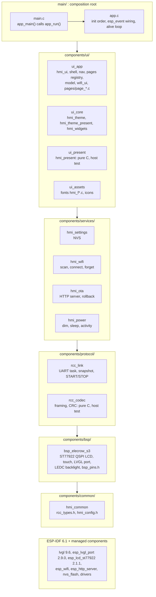
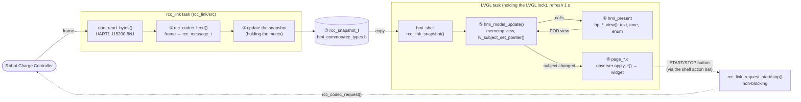
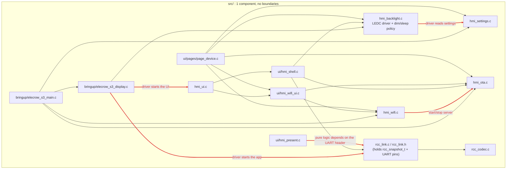
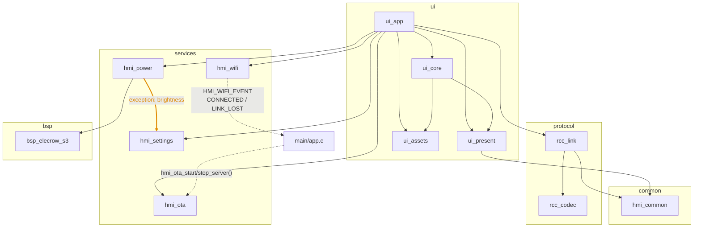
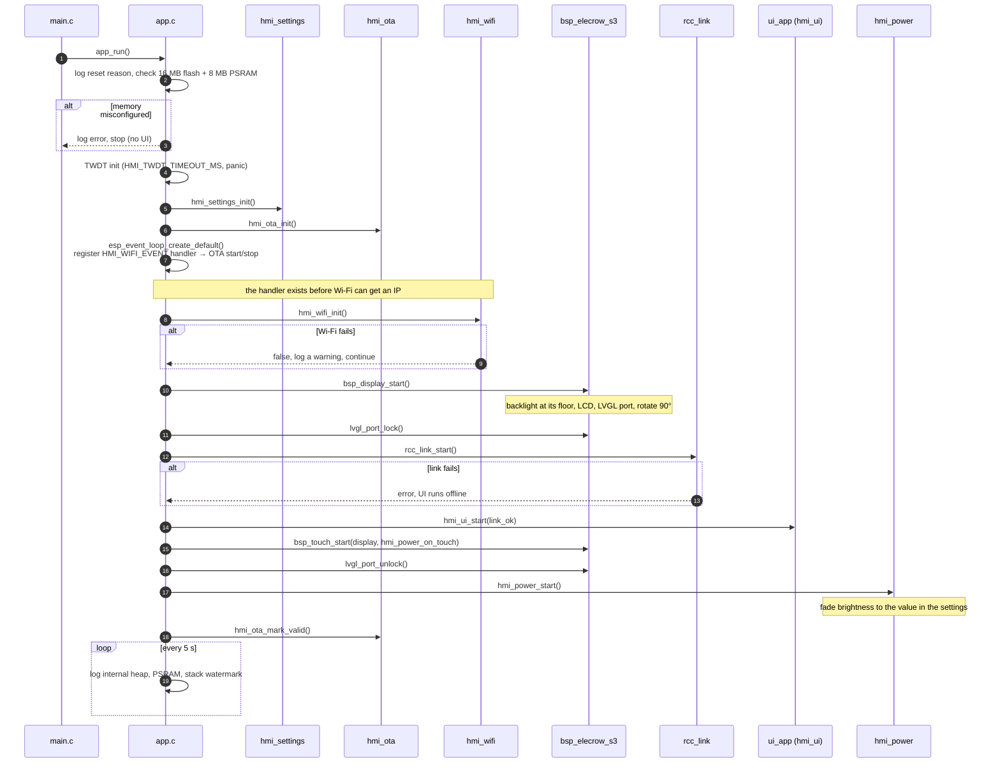

> **Historical record.** Archived on 2026-11-27 from `docs/firmware-restructure-design.md` and **translated from Vietnamese to English the same day**; the content is otherwise unchanged. It explains why the firmware is laid out as it is. Current rules live in [`firmware/components/README.md`](../../../firmware/components/README.md); the decision summary is [ADR-0001](../0001-esp-idf-component-layout.md). Paths such as `new_firmware/...` now mean `firmware/...`. Where this record and the current source differ (for example the Mermaid diagrams, the LVGL Pro layouts added later, the 128 KB LVGL heap), the source wins.

# Firmware restructure design and migration to ESP-IDF (idf.py)

Status: **phases 1 and 2 done, not yet flashed to a board** (2026-11-27). `new_firmware/` was renamed to `firmware/` and the old PlatformIO project was deleted (it remains in git history). The `new_firmware/...` paths below are historical notes; they are now `firmware/...`. The architecture map lives in the code itself: `firmware/components/README.md`.

Phase 1 results (checked on the development machine):
- `new_firmware/main/` was identical to `firmware/src/` (`diff -r --strip-trailing-cr` showed no difference).
- `idf.py build` (ESP-IDF 6.1.0, Windows) succeeded with 0 warnings. `firmware.bin` was 0x1572d0 bytes; the app partition had 62 % free.
- `sdkconfig` generated from `sdkconfig.defaults` matched `firmware/sdkconfig.elecrow_s3` of the PlatformIO project. Only `CONFIG_PARTITION_TABLE_(CUSTOM_)FILENAME` differed (`partitions/elecrow_s3.csv` became `partitions.csv`); the CSV content was unchanged.
- Host tests passed: `rcc_codec` ALL PASSED, `hmi_present` 304/304, `controller_sim` 33 tests OK (1 skipped).
- Simulator: `PIXEL DIFF: none` (80/80 images against the baseline recorded from `firmware/`), `MORPH DIFF: none` (384 + 10).
- Remaining: flash to a board and compare the boot log (done by the user).

Phase 2 results: 6 commits (2.1 to 2.6). Every commit built with 0 warnings (`-Wall -Wextra -Werror`), host tests passed, simulator `PIXEL DIFF: none` (80/80) and `MORPH DIFF: none`. `firmware.bin` was 0x157480 (previously 0x1572d0). `dependencies.lock` changed only in `manifest_hash`; library versions were kept.

**Where the result differs from the original design** (the sections below were corrected accordingly):

| Original design | Actual | Reason |
|---|---|---|
| OTA listens to `IP_EVENT_STA_GOT_IP` / `WIFI_EVENT_STA_DISCONNECTED` itself | `hmi_wifi` posts `HMI_WIFI_EVENT_CONNECTED` / `_LINK_LOST` at the two places that used to call OTA. `app.c` listens and calls `hmi_ota_start/stop_server()` | Previously the server stopped only when an *established* connection dropped, not when the user disconnected manually or a connection attempt failed. Listening to the raw `DISCONNECTED` event would change that behaviour |
| UART pins moved to `bsp_pins.h`, configuration passed in from `app.c`, Device page reads it through `rcc_link_get_config()` | The `RCC_LINK_*` constants are in `hmi_config.h` (`hmi_common`). `rcc_link` and the Device page include that header | One place for constants, no new API, no stub needed for the simulator |
| `bsp_display_start()` also initializes touch | Touch is separate: `bsp_touch_start(display, cb)`, called after `hmi_ui_start()` as in the old order | Keeps the start-up order |
| (not in the design) | The touch driver calls a callback `bsp_touch_activity_cb_t` instead of `hmi_backlight_*`. `app.c` passes `hmi_power_on_touch` | Previously the bsp called upward into the policy layer |
| `bsp_elecrow_s3 → hmi_common` | The bsp depends on no project component | No longer needed once the UART pins live in `hmi_config.h` |
| Fonts declared in `hmi_theme.h` | Declared in `ui_assets/include/hmi_fonts.h` | An asset declares itself |
| `hmi_backlight_is_dimmed()`, `_notify_activity()` are public API | Gone: `notify_activity` became a static function and `is_dimmed` was deleted because nothing called it | The `hmi_power` API is `start`, `on_touch`, `set_brightness`, `tick` |
| Log tag `elecrow_s3` | Log tag `app` | Messages unchanged |

## 1. Design Decision Record

**Decisions**
1. Drop PlatformIO and build with `idf.py` (ESP-IDF 6.1.0) in `new_firmware/` (at the repository root).
2. Proceed in two phases: (1) move as-is and run identically; (2) restructure step by step inside `new_firmware/`.
3. Structure **A**: directories by layer (`common / bsp / protocol / services / ui`), each module an ESP-IDF component with `include/` (public) and `src/` (private). The organisation of `solar-logger` was used as a reference.
4. APIs are **direct C functions** with a module prefix (`rcc_link_snapshot()`), not function-pointer structs.
5. Services do not call each other. Runtime dependencies go through `esp_event`, and the wiring lives in `main/app.c`.

**Background**
- PlatformIO was only a wrapper: `framework = espidf`, `src/CMakeLists.txt` was already `idf_component_register`, and `idf_component.yml` and `dependencies.lock` already existed. The PlatformIO-specific parts were only the board, flash (16 MB/QIO/80 MHz), partition path and monitor speed.
- The code had become tangled because:
  - one flat `src/` component held drivers, protocol, services and UI;
  - `elecrow_s3_display_start()` started `rcc_link` and `hmi_ui` itself;
  - `rcc_snapshot_t` (the data contract) lived in the UART transport header;
  - `hmi_wifi.c` called `hmi_ota_start/stop_server()`;
  - `hmi_backlight.c` was both an LEDC driver and a dim/sleep policy that read settings.
- The things that cost users the most time: finding where code lives, adding controller data, Settings/Wi-Fi/OTA, and hardware/start-up.

**Why this choice**
- With components and `PRIV_REQUIRES`, an include from the wrong layer fails at build time instead of relying on convention.
- Direct functions keep go-to-definition working. The simulator and host tests already replace modules with link-time stubs (`tools/sim/sim_stubs.c`), so no extra indirection is needed.
- `IP_EVENT_STA_GOT_IP` and `WIFI_EVENT_STA_DISCONNECTED` are standard IDF events. (In practice `hmi_wifi` posts its own event and `app.c` connects it to OTA; see the table at the top.)

**Alternatives considered**
- **B: one component per layer.** Does not stop services from calling each other within a layer, which is exactly the current tangle.
- **C: split by feature.** LVGL would spread into every slice and break the UI layers that work well (`hmi_present` is host-tested, retained mode).
- **Function-pointer structs as in solar-logger.** Adds an indirection although each module has only one real implementation.
- **`create()/destroy()` on the heap.** The modules are singletons, and the 64 KB LVGL heap is tracked closely.

**Risks and mitigations**

| Risk | Mitigation |
|---|---|
| `sdkconfig` through `idf.py` differs from the PlatformIO one (LVGL Kconfig, PSRAM, console) | Phase 1 diffs the generated `sdkconfig` against `firmware/sdkconfig.elecrow_s3`. Accept a difference only with a written explanation |
| Component versions drift (lvgl 9.6.0~1, esp_lvgl_port 2.9.0, esp_lcd_st77922 2.1.1) | Copy `dependencies.lock`, pin IDF 6.1.0 |
| Start-up order changes when moved into `app.c` | Keep the order of section 4 and log each step |
| An OTA handler registered after Wi-Fi already has an IP would miss the event | `app.c` creates the default event loop and registers the `HMI_WIFI_EVENT` handler before `hmi_wifi_init()` |
| A refactor changes the UI without anyone noticing | After every step: host tests and `check.sh` must print `PIXEL DIFF: none` and `MORPH DIFF: none` |
| Tools outside `firmware/` point at `firmware/src` | Update `tools/snapshot/*`, `tools/tests/rcc_link_host_test.c`, `gen_icons.py`, `tools/sim/Makefile`, `test/host/run.sh` and the documentation |

## 2. Target structure

```
new_firmware/
├── CMakeLists.txt              EXTRA_COMPONENT_DIRS = components/{common,bsp,protocol,services,ui}
├── sdkconfig.defaults          (from config/elecrow_s3.defaults plus the needed LVGL entries)
├── partitions.csv              (from partitions/elecrow_s3.csv)
├── dependencies.lock
├── main/
│   ├── CMakeLists.txt  idf_component.yml
│   ├── main.c                  app_main(): calls app_run(), nothing else
│   ├── app.c / app.h           composition root: memory check, TWDT, init in order, event wiring, alive loop
├── components/
│   ├── common/
│   │   └── hmi_common/         rcc_types.h (rcc_snapshot_t, rcc_command_state_t, RCC_EVENT_SLOTS), hmi_config.h
│   ├── bsp/
│   │   └── bsp_elecrow_s3/     ST77922 QSPI LCD, touch, LVGL port, LEDC backlight (duty/fade only); src/bsp_pins.h (private)
│   ├── protocol/
│   │   ├── rcc_codec/          pure-C framing/CRC, host test
│   │   └── rcc_link/           UART task, snapshot, START/STOP requests; UART constants in hmi_config.h
│   ├── services/
│   │   ├── hmi_settings/       NVS
│   │   ├── hmi_wifi/           scan/connect/forget; does not know OTA exists
│   │   ├── hmi_ota/            arm/disarm, HTTP server, rollback; app.c starts/stops it on HMI_WIFI_EVENT
│   │   └── hmi_power/          dim/sleep/activity policy (split from hmi_backlight)
│   └── ui/
│       ├── ui_assets/          fonts (hmi_f*.c), icons (hmi_icons.c)
│       ├── ui_present/         hmi_present: pure C, no LVGL, host test
│       ├── ui_core/            hmi_theme, hmi_theme_present, hmi_widgets
│       └── ui_app/             hmi_ui (public API), shell, nav, pages registry, model, wifi_ui, pages/page_*.c
├── test/host/                  test_rcc_codec.c, test_hmi_present.c, run.sh, test_controller_sim.py
└── tools/                      sim/ (simulator + pixel/morph check), controller_sim.py, gen_icons.py
```

Each component:
```
<module>/
├── CMakeLists.txt     idf_component_register(SRCS ... INCLUDE_DIRS include PRIV_INCLUDE_DIRS src
│                                             REQUIRES <what appears in the public header>
│                                             PRIV_REQUIRES <what only the .c files use>)
├── include/<module>.h public API
└── src/               .c files and internal headers
```
Prefer `PRIV_REQUIRES`. Use `REQUIRES` only when the public header needs the other component's types, so dependencies do not spread implicitly.

### Diagram 1: layers and components (where code lives)

An arrow between layers means "may depend on the layer below". A layer may skip the adjacent one, for example `ui_app` calls `rcc_link` directly. The upward direction is never allowed.



### Diagram 4: data flow controller → screen (where to edit when adding a field)

The two tasks meet only at `rcc_snapshot_t`, protected by a mutex inside `rcc_link`. The numbers ① to ⑥ are the order of the places to edit when adding a data field from the controller.



| Step | Component | What to do |
|---|---|---|
| ① | `rcc_codec` | Decode the new field (only if the protocol changes), with a host test |
| ② | `rcc_link` | Copy the value into the snapshot |
| ③ | `hmi_common` | Add the field to `rcc_snapshot_t` |
| ④ | `ui_present` | Add the field to the view, compute text/tone in `hp_*_view()`, with a host test |
| ⑤ | `ui_app/hmi_model` | Edit only when a new view is needed |
| ⑥ | `ui_app/pages` | Create the widget in `enter`, set the value in `apply_*` |

## 3. Dependency rules

Dependencies point downward only: `ui → services → protocol → bsp → common`. `main` sees every component.

| Component | May depend on (in the project) | IDF / managed libraries |
|---|---|---|
| `hmi_common` | none | none |
| `bsp_elecrow_s3` | none | lvgl, esp_lcd, esp_lcd_st77922, esp_lvgl_port, esp_driver_{spi,gpio,i2c,ledc} |
| `rcc_codec` | none | none (pure C) |
| `rcc_link` | `rcc_codec`, `hmi_common` | esp_driver_uart, esp_driver_gpio, freertos, esp_timer |
| `hmi_settings` | none | nvs_flash |
| `hmi_wifi` | none | esp_wifi, esp_netif, esp_event, nvs_flash |
| `hmi_ota` | none | app_update, esp_http_server, esp_event |
| `hmi_power` | `bsp_elecrow_s3`, `hmi_settings` | esp_timer |
| `ui_assets` | none | lvgl |
| `ui_present` | `hmi_common` | none (pure C) |
| `ui_core` | `ui_assets`, `ui_present` | lvgl |
| `ui_app` | `ui_core`, `ui_present`, `ui_assets`, `rcc_link`, `hmi_settings`, `hmi_wifi`, `hmi_ota`, `hmi_power`, `hmi_common` | lvgl, esp_system (TWDT) |

### Diagram 2a: current dependencies (`firmware/src`, a single component)

The red edges are the ones that are cut or moved in the new structure. Because everything sits in one component, nothing prevents these edges from appearing.



### Diagram 2b: proposed dependencies (`PRIV_REQUIRES`)

A solid edge is a build-time dependency. The orange edge is a documented exception. Dotted edges are run-time events through `esp_event`, not build dependencies. `main` depends on every component, so its edges are not drawn.



What changes between 2a and 2b:

| Current edge | In the new structure |
|---|---|
| `elecrow_s3_display → rcc_link, hmi_ui` | Cut. `app.c` starts the link and the UI |
| `hmi_backlight → hmi_settings` | The LEDC driver moves into `bsp`, the dim/sleep policy becomes `hmi_power` (documented exception) |
| `hmi_wifi → hmi_ota` | Cut. `hmi_wifi` posts `HMI_WIFI_EVENT` and `app.c` calls OTA |
| `hmi_present → rcc_link.h` | Becomes `ui_present → hmi_common` (`rcc_types.h`) |
| `shell, page_device → hmi_backlight` | Become `ui_app → hmi_power` |

Rules:
1. **Services do not call each other.** The only documented exception is `hmi_power → hmi_settings` (read and store brightness). `hmi_settings` is a leaf store and depends on nothing.
2. **The UI does not touch `bsp`.** Hardware information the Device page must show (UART pins, baud) lives in `hmi_config.h` (`hmi_common`).
3. **`rcc_snapshot_t` is the single data contract between the controller and the UI.** It lives in `hmi_common/rcc_types.h` and does not pull in `esp_err.h`, so host tests need no stub.
4. Keep the existing UI rules from `firmware/src/ui/README.md`: pages do not call `rcc_link_*`, logic lives in `hmi_present`, the palette lives only in `hmi_theme.h`, retained mode uses enter/update/leave.
5. There is no alternative implementation at run time. The simulator and host tests replace modules with link-time stubs.

## 4. Start-up order in `app.c`

Keep the current behaviour of `elecrow_s3_main.c` and `elecrow_s3_display.c`. The only difference is gathering everything in one place.

1. Log the reset reason and check 16 MB flash and 8 MB PSRAM. If wrong, log an error and stop without building the UI (as today).
2. Initialise the TWDT (`HMI_TWDT_TIMEOUT_MS`, with panic).
3. `hmi_settings_init()`.
4. `hmi_ota_init()`, then create the default event loop and register the `HMI_WIFI_EVENT` handler (CONNECTED starts the server, LINK_LOST stops it).
5. `hmi_wifi_init()`. On failure only warn; the Wi-Fi screen will say "unavailable".
6. `bsp_display_start(&display)`: backlight at its floor, LCD, LVGL port, screen rotation. It **no longer** starts the link or the UI.
7. Take the LVGL lock, call `rcc_link_start()`, `hmi_ui_start(link_ok)`, `bsp_touch_start(display, hmi_power_on_touch)`, invalidate, then release the lock.
8. `hmi_power_start()`: bring the brightness to the value in the settings (with a fade).
9. `hmi_ota_mark_valid()`.
10. Alive loop every 5 s: log internal heap, PSRAM and stack watermark.

### Diagram 3: start-up sequence



## 5. Roadmap

**Phase 1: move as-is** (not one line of code changes)
- Copy `src/` to `new_firmware/main/` (one component), with the same `idf_component.yml`, `dependencies.lock`, defaults and partitions.
- `idf.py set-target esp32s3 && idf.py build` succeeds, with the full `-Wall -Wextra -Werror`.
- Compare the generated `sdkconfig` with `firmware/sdkconfig.elecrow_s3`. No unexplained difference is allowed.
- Point `test/host/run.sh` and `tools/sim` at the new paths. Host tests must pass and `check.sh` must print `PIXEL DIFF: none`.
- Flash to a board: the boot log must match (Flash/PSRAM, TWDT, UART1 link, OTA mark valid). The user does this step on the hardware.

**Phase 2: restructure.** Each step is one commit, and the build, host tests and pixel/morph diff must all be clean:
1. `hmi_common`: split `rcc_types.h` out of `rcc_link.h`, move `hmi_config.h`.
2. `rcc_codec`, `rcc_link` (the UART constants are already in `hmi_config.h` from step 1).
3. `bsp_elecrow_s3`: display, touch, LVGL port, LEDC driver. Remove the link/UI start from the display code.
4. Services: `hmi_settings`, `hmi_ota`, `hmi_wifi` (remove the OTA calls, post `HMI_WIFI_EVENT`), `hmi_power` (renamed from the backlight policy).
5. UI: `ui_assets`, `ui_present`, `ui_core`, `ui_app`.
6. `main/app.c` as the composition root, `main.c` reduced to a few lines.
7. Documentation: architecture README, dependency table, the "add a controller data field" checklist, update the tools outside `firmware/`.

## 6. Requirements

**Explicit (stated by the user)**
- Build entirely with ESP-IDF (`idf.py`), no PlatformIO any more.
- A clear layer and module structure that is easy to read and change. Use the organisation of solar-logger as a reference.
- Keep every verification tool: the simulator and its 80 pixel-diff images, `check_morph`, host tests, `controller_sim.py`.

**Implicit**
- Behaviour and UI unchanged: pixel diff and morph diff must both be none, and the UART protocol unchanged.
- Keep the memory configuration (PSRAM octal 80 MHz), the dual-OTA partition table with rollback, and the USB-Serial-JTAG console (the external UART carries no log).
- Keep `-Wall -Wextra -Werror` for project code.
- Keep the 64 KB LVGL heap constraint and add no new dynamic allocation.
- Every service call from the UI still runs under the LVGL lock and must not block.
- Buildable from an ESP-IDF environment on Windows (PowerShell/cmd). Note that `idf.py` does not run when `MSYSTEM` is set (Git Bash).

## 7. Edge cases

- **Wrong memory configuration:** stop before building the UI, as today.
- **`rcc_link_start` fails:** the UI still runs in the offline state (`link_ok = false`). STOP is still accepted while offline.
- **`hmi_wifi_init` fails:** OTA never receives GOT_IP, so the server does not run. The Wi-Fi screen reports it as unavailable.
- **Connection lost while receiving OTA:** `HMI_WIFI_EVENT_LINK_LOST` stops the server (and disarms). Rollback in the bootloader protects the half-written image.
- **CONNECTED arrives before the handler is registered:** cannot happen, because `app.c` registers it before `hmi_wifi_init()`.
- **Event-loop queue full:** `hmi_wifi` posts with a zero timeout (it never blocks the event-loop task itself) and logs a warning. The server may then fail to start or stop that time.
- **The event handler runs in the `sys_evt` task:** the same context as today (the Wi-Fi handler already called OTA from there), unchanged.
- **Brightness changed while dimmed or asleep:** `hmi_power` keeps the current logic, only the location of the code changes.
- **Simulator:** `HMI_SIM` and the stubs must be updated for the new include paths. Public `ui_*` headers must not pull in IDF headers.
- **Regenerating icons or fonts:** `gen_icons.py` writes to `components/ui/ui_assets/src/`.

## 8. Out of scope

- UI changes, new pages, moving the Device page to retained mode.
- Changes to the controller protocol (`rcc_codec`) or the content of `rcc_snapshot_t`.
- Function-pointer-struct APIs, heap-allocated instances.
- Automated CI.
- Deleting `firmware/` (PlatformIO) and the duplicate `firmware/new_firmware/` directory. Only with the user's agreement, after phase 1 runs on a board.

## 9. Open questions

- (Done) Rename `new_firmware/` to `firmware/` and delete the old PlatformIO project. The user decided to do this before having a board to test on.
- (Done) The `rcc_link` test moved to `firmware/test/host/test_rcc_link.c` and runs in `run.sh`. It had been broken before because the stub lacked `uart_port_t` / `gpio_num_t`. `tools/snapshot` builds from the UI components; it was broken before as well, because since the UI refactor it no longer compiled `ui/*.c`. The README and `docs/` moved to `idf.py` and the component paths.
- (Resolved) The duplicate directory `firmware/new_firmware/` no longer exists.
