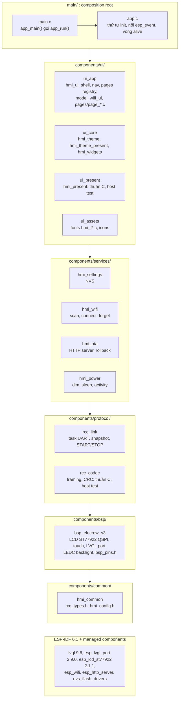
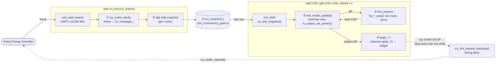
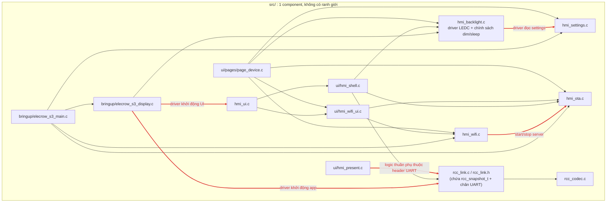
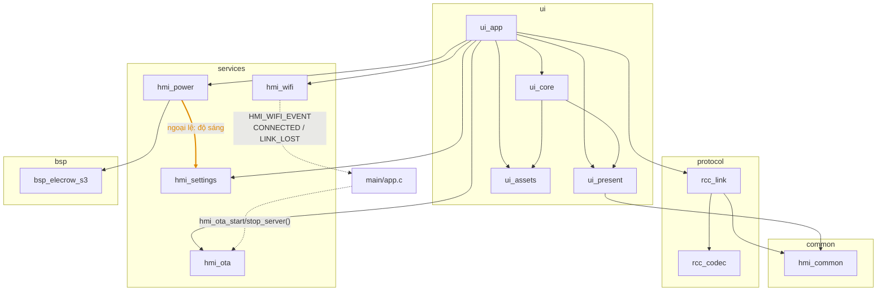
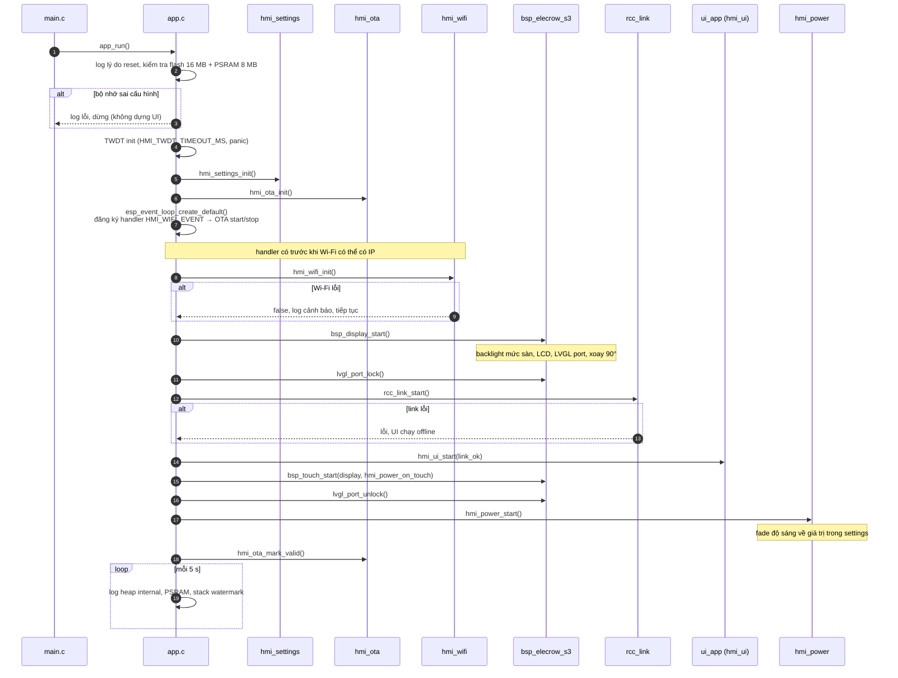

# Thiết kế tái cấu trúc firmware HMI và chuyển sang ESP-IDF (idf.py)

Trạng thái: **giai đoạn 1 và 2 đã xong, chưa nạp board** (2026-11-27). `new_firmware/` đã đổi tên thành `firmware/`, dự án PlatformIO cũ đã bị xoá (vẫn còn trong lịch sử git). Các đường dẫn `new_firmware/...` bên dưới là ghi chép lịch sử; hiện chúng là `firmware/...`. Bản đồ kiến trúc nằm ngay trong code: `firmware/components/README.md`.

Kết quả giai đoạn 1 (kiểm tra trên máy dev):
- `new_firmware/main/` giống hệt `firmware/src/` (`diff -r --strip-trailing-cr` không có khác biệt).
- `idf.py build` (ESP-IDF 6.1.0, Windows) chạy thành công, 0 warning. `firmware.bin` có kích thước 0x1572d0, partition app còn trống 62 %.
- `sdkconfig` sinh từ `sdkconfig.defaults` khớp với `firmware/sdkconfig.elecrow_s3` của PlatformIO. Chỉ khác `CONFIG_PARTITION_TABLE_(CUSTOM_)FILENAME` (`partitions/elecrow_s3.csv` thành `partitions.csv`), nội dung CSV không đổi.
- Host test pass: `rcc_codec` ALL PASSED, `hmi_present` 304/304, `controller_sim` 33 test OK (1 skip).
- Simulator: `PIXEL DIFF: none` (80/80 ảnh so với baseline ghi từ `firmware/`), `MORPH DIFF: none` (384 + 10).
- Còn lại: nạp lên board và đối chiếu boot log (người dùng làm).

Kết quả giai đoạn 2: 6 commit (2.1 đến 2.6), mỗi commit đều build 0 warning (`-Wall -Wextra -Werror`), host test pass, simulator `PIXEL DIFF: none` (80/80) và `MORPH DIFF: none`. `firmware.bin` 0x157480 (trước là 0x1572d0). `dependencies.lock` chỉ đổi `manifest_hash`, phiên bản thư viện giữ nguyên.

**Những điểm làm khác bản thiết kế ban đầu** (các mục bên dưới đã sửa theo):

| Thiết kế ban đầu | Thực tế | Lý do |
|---|---|---|
| OTA tự nghe `IP_EVENT_STA_GOT_IP` / `WIFI_EVENT_STA_DISCONNECTED` | `hmi_wifi` phát `HMI_WIFI_EVENT_CONNECTED` / `_LINK_LOST` đúng tại hai chỗ trước đây gọi OTA. `app.c` nghe và gọi `hmi_ota_start/stop_server()` | Trước đây server chỉ dừng khi một kết nối *đã thiết lập* bị rớt, không dừng khi người dùng tự ngắt hay khi kết nối thất bại. Nghe sự kiện thô `DISCONNECTED` sẽ đổi hành vi này |
| Chân UART chuyển sang `bsp_pins.h`, cấu hình truyền vào từ `app.c`, trang Device đọc qua `rcc_link_get_config()` | Các hằng `RCC_LINK_*` nằm trong `hmi_config.h` (`hmi_common`). `rcc_link` và trang Device include header đó | Một chỗ duy nhất cho hằng số, không thêm API, không cần stub cho simulator |
| `bsp_display_start()` khởi tạo cả touch | Touch tách riêng: `bsp_touch_start(display, cb)`, gọi sau `hmi_ui_start()` như thứ tự cũ | Giữ nguyên thứ tự khởi động |
| (không có trong thiết kế) | Driver touch gọi callback `bsp_touch_activity_cb_t` thay cho `hmi_backlight_*`. `app.c` truyền vào `hmi_power_on_touch` | Trước đây bsp gọi ngược lên tầng chính sách |
| `bsp_elecrow_s3 → hmi_common` | bsp không phụ thuộc component nào của dự án | Không cần nữa sau khi chân UART nằm ở `hmi_config.h` |
| Font khai báo trong `hmi_theme.h` | Khai báo trong `ui_assets/include/hmi_fonts.h` | Asset tự khai báo chính nó |
| `hmi_backlight_is_dimmed()`, `_notify_activity()` là API public | Không còn: `notify_activity` thành hàm static, còn `is_dimmed` bị xoá vì không còn ai gọi | API của `hmi_power` gồm `start`, `on_touch`, `set_brightness`, `tick` |
| Log tag `elecrow_s3` | Log tag `app` | Thông điệp giữ nguyên |

## 1. Design Decision Record

**Quyết định**
1. Bỏ PlatformIO, build bằng `idf.py` (ESP-IDF 6.1.0) trong `new_firmware/` (ở gốc repo).
2. Đi theo 2 giai đoạn: (1) chuyển nguyên trạng, chạy giống hệt; (2) tái cấu trúc từng bước ngay trong `new_firmware/`.
3. Cấu trúc **A**: thư mục theo layer (`common / bsp / protocol / services / ui`), mỗi module là một ESP-IDF component có `include/` (public) và `src/` (private). Tham khảo cách tổ chức của `solar-logger`.
4. API là **hàm C trực tiếp** có tiền tố module (`rcc_link_snapshot()`), không dùng struct con trỏ hàm.
5. Service không gọi chéo nhau. Phụ thuộc runtime đi qua `esp_event`, còn việc nối dây nằm trong `main/app.c`.

**Bối cảnh**
- PlatformIO chỉ bọc ngoài: `framework = espidf`, `src/CMakeLists.txt` vốn đã là `idf_component_register`, và đã có `idf_component.yml` cùng `dependencies.lock`. Phần riêng của PlatformIO chỉ gồm board, flash (16 MB/QIO/80 MHz), đường dẫn partition và monitor speed.
- Code bị rối vì:
  - Một component `src/` phẳng chứa cả driver, giao thức, service và UI.
  - `elecrow_s3_display_start()` tự khởi động `rcc_link` và `hmi_ui`.
  - `rcc_snapshot_t` (hợp đồng dữ liệu) nằm trong header transport UART.
  - `hmi_wifi.c` gọi `hmi_ota_start/stop_server()`.
  - `hmi_backlight.c` vừa là driver LEDC vừa là chính sách dim/sleep đọc settings.
- Những điểm người dùng thấy mất thời gian nhất: tìm code nằm ở đâu, thêm dữ liệu controller, Settings/Wi-Fi/OTA, phần cứng/khởi động.

**Lý do chọn**
- Có component với `PRIV_REQUIRES` thì include sai layer sẽ báo lỗi ngay lúc build, không phải dựa vào quy ước.
- Hàm trực tiếp vẫn giữ được go-to-definition. Simulator và host test đã thay module bằng link-time stub (`tools/sim/sim_stubs.c`), nên không cần thêm lớp gián tiếp.
- `IP_EVENT_STA_GOT_IP` và `WIFI_EVENT_STA_DISCONNECTED` là sự kiện chuẩn của IDF. (Thực tế: `hmi_wifi` phát sự kiện riêng và `app.c` nối sang OTA; xem bảng ở đầu tài liệu.)

**Các phương án đã cân nhắc**
- **B: mỗi layer là 1 component.** Không ngăn được service gọi chéo trong cùng layer, mà đó lại đúng là kiểu rối hiện tại.
- **C: chia theo tính năng.** LVGL sẽ lan ra mọi slice và phá vỡ các layer UI đang chạy tốt (`hmi_present` được host test, retained mode).
- **Struct con trỏ hàm như solar-logger.** Thêm một lớp gián tiếp trong khi mỗi module chỉ có một cài đặt thật.
- **`create()/destroy()` trên heap.** Các module là singleton, và heap LVGL 64 KB đang bị theo dõi sát.

**Rủi ro và cách giảm thiểu**

| Rủi ro | Cách giảm thiểu |
|---|---|
| `sdkconfig` qua `idf.py` khác bản PlatformIO (LVGL Kconfig, PSRAM, console) | Giai đoạn 1 diff `sdkconfig` sinh ra với `firmware/sdkconfig.elecrow_s3`. Chấp nhận khác biệt chỉ khi đã có giải thích bằng văn bản |
| Phiên bản component trôi (lvgl 9.6.0~1, esp_lvgl_port 2.9.0, esp_lcd_st77922 2.1.1) | Chép `dependencies.lock`, khoá IDF 6.1.0 |
| Thứ tự khởi động thay đổi khi chuyển vào `app.c` | Giữ nguyên thứ tự ở mục 4, log từng bước |
| Handler OTA đăng ký sau khi Wi-Fi đã có IP thì sẽ lỡ sự kiện | `app.c` tạo default event loop và đăng ký handler `HMI_WIFI_EVENT` trước `hmi_wifi_init()` |
| Refactor làm đổi giao diện mà không ai thấy | Sau mỗi bước: host test và `check.sh` phải in `PIXEL DIFF: none` và `MORPH DIFF: none` |
| Công cụ ngoài `firmware/` trỏ vào `firmware/src` | Cập nhật `tools/snapshot/*`, `tools/tests/rcc_link_host_test.c`, `gen_icons.py`, `tools/sim/Makefile`, `test/host/run.sh` và tài liệu |

## 2. Cấu trúc đích

```
new_firmware/
├── CMakeLists.txt              EXTRA_COMPONENT_DIRS = components/{common,bsp,protocol,services,ui}
├── sdkconfig.defaults          (từ config/elecrow_s3.defaults cùng các mục LVGL cần thiết)
├── partitions.csv              (từ partitions/elecrow_s3.csv)
├── dependencies.lock
├── main/
│   ├── CMakeLists.txt  idf_component.yml
│   ├── main.c                  app_main(): gọi app_run(), không làm gì khác
│   ├── app.c / app.h           composition root: kiểm tra bộ nhớ, TWDT, init theo thứ tự, nối event, vòng alive
├── components/
│   ├── common/
│   │   └── hmi_common/         rcc_types.h (rcc_snapshot_t, rcc_command_state_t, RCC_EVENT_SLOTS), hmi_config.h
│   ├── bsp/
│   │   └── bsp_elecrow_s3/     LCD ST77922 QSPI, touch, LVGL port, LEDC backlight (chỉ duty/fade); src/bsp_pins.h (riêng tư)
│   ├── protocol/
│   │   ├── rcc_codec/          framing/CRC thuần C, host test
│   │   └── rcc_link/           task UART, snapshot, request START/STOP; hằng UART trong hmi_config.h
│   ├── services/
│   │   ├── hmi_settings/       NVS
│   │   ├── hmi_wifi/           scan/connect/forget; không biết OTA tồn tại
│   │   ├── hmi_ota/            arm/disarm, HTTP server, rollback; app.c start/stop theo HMI_WIFI_EVENT
│   │   └── hmi_power/          chính sách dim/sleep/activity (tách từ hmi_backlight)
│   └── ui/
│       ├── ui_assets/          fonts (hmi_f*.c), icons (hmi_icons.c)
│       ├── ui_present/         hmi_present: thuần C, không LVGL, host test
│       ├── ui_core/            hmi_theme, hmi_theme_present, hmi_widgets
│       └── ui_app/             hmi_ui (API public), shell, nav, pages registry, model, wifi_ui, pages/page_*.c
├── test/host/                  test_rcc_codec.c, test_hmi_present.c, run.sh, test_controller_sim.py
└── tools/                      sim/ (simulator + pixel/morph check), controller_sim.py, gen_icons.py
```

Mỗi component:
```
<module>/
├── CMakeLists.txt     idf_component_register(SRCS ... INCLUDE_DIRS include PRIV_INCLUDE_DIRS src
│                                             REQUIRES <cái xuất hiện trong header public>
│                                             PRIV_REQUIRES <cái chỉ dùng trong .c>)
├── include/<module>.h API public
└── src/               .c và header nội bộ
```
Ưu tiên `PRIV_REQUIRES`. Chỉ dùng `REQUIRES` khi header public cần kiểu dữ liệu của component kia, để phụ thuộc không lan truyền ngầm.

### Sơ đồ 1: Layer và component (code nằm ở đâu)

Mũi tên giữa các layer nghĩa là "được phép phụ thuộc vào layer bên dưới". Một layer có thể bỏ qua layer kề nó, ví dụ `ui_app` gọi thẳng `rcc_link`. Chiều ngược lên thì không bao giờ được phép.



### Sơ đồ 4: Luồng dữ liệu controller → màn hình (thêm một trường thì sửa ở đâu)

Hai task chỉ gặp nhau ở `rcc_snapshot_t`, được bảo vệ bằng mutex trong `rcc_link`. Các số ① đến ⑥ là thứ tự các chỗ phải sửa khi thêm một trường dữ liệu từ controller.



| Bước | Component | Việc phải làm |
|---|---|---|
| ① | `rcc_codec` | Giải mã trường mới (chỉ khi giao thức đổi), có host test |
| ② | `rcc_link` | Chép giá trị vào snapshot |
| ③ | `hmi_common` | Thêm trường vào `rcc_snapshot_t` |
| ④ | `ui_present` | Thêm trường vào view, tính text/tone trong `hp_*_view()`, có host test |
| ⑤ | `ui_app/hmi_model` | Chỉ phải sửa khi cần một view mới |
| ⑥ | `ui_app/pages` | Tạo widget trong `enter`, gán giá trị trong `apply_*` |

## 3. Quy tắc phụ thuộc

Hướng phụ thuộc chỉ đi xuống: `ui → services → protocol → bsp → common`. `main` được thấy mọi component.

| Component | Được phụ thuộc vào (trong dự án) | Thư viện IDF / managed |
|---|---|---|
| `hmi_common` | không có | không có |
| `bsp_elecrow_s3` | không có | lvgl, esp_lcd, esp_lcd_st77922, esp_lvgl_port, esp_driver_{spi,gpio,i2c,ledc} |
| `rcc_codec` | không có | không có (thuần C) |
| `rcc_link` | `rcc_codec`, `hmi_common` | esp_driver_uart, esp_driver_gpio, freertos, esp_timer |
| `hmi_settings` | không có | nvs_flash |
| `hmi_wifi` | không có | esp_wifi, esp_netif, esp_event, nvs_flash |
| `hmi_ota` | không có | app_update, esp_http_server, esp_event |
| `hmi_power` | `bsp_elecrow_s3`, `hmi_settings` | esp_timer |
| `ui_assets` | không có | lvgl |
| `ui_present` | `hmi_common` | không có (thuần C) |
| `ui_core` | `ui_assets`, `ui_present` | lvgl |
| `ui_app` | `ui_core`, `ui_present`, `ui_assets`, `rcc_link`, `hmi_settings`, `hmi_wifi`, `hmi_ota`, `hmi_power`, `hmi_common` | lvgl, esp_system (TWDT) |

### Sơ đồ 2a: Phụ thuộc hiện trạng (`firmware/src`, một component duy nhất)

Các cạnh màu đỏ là những chỗ sẽ bị cắt hoặc chuyển đi trong cấu trúc mới. Vì mọi thứ nằm chung một component nên không có gì ngăn các cạnh này xuất hiện.



### Sơ đồ 2b: Phụ thuộc đề xuất (`PRIV_REQUIRES`)

Cạnh liền là phụ thuộc lúc build. Cạnh màu cam là ngoại lệ đã ghi nhận. Cạnh chấm là sự kiện lúc chạy qua `esp_event`, không phải phụ thuộc build. `main` phụ thuộc mọi component nên không vẽ cạnh của nó.



Những gì thay đổi giữa 2a và 2b:

| Cạnh hiện trạng | Trong cấu trúc mới |
|---|---|
| `elecrow_s3_display → rcc_link, hmi_ui` | Bị cắt. `app.c` khởi động link và UI |
| `hmi_backlight → hmi_settings` | Driver LEDC vào `bsp`, chính sách dim/sleep thành `hmi_power` (ngoại lệ đã ghi) |
| `hmi_wifi → hmi_ota` | Bị cắt. `hmi_wifi` phát `HMI_WIFI_EVENT`, `app.c` gọi OTA |
| `hmi_present → rcc_link.h` | Chuyển sang `ui_present → hmi_common` (`rcc_types.h`) |
| `shell, page_device → hmi_backlight` | Chuyển sang `ui_app → hmi_power` |

Quy tắc:
1. **Service không gọi chéo nhau.** Ngoại lệ duy nhất được ghi nhận là `hmi_power → hmi_settings` (đọc và lưu độ sáng). `hmi_settings` là kho dữ liệu lá, nó không phụ thuộc vào ai.
2. **UI không chạm `bsp`.** Thông tin phần cứng mà trang Device cần hiển thị (chân UART, baud) nằm trong `hmi_config.h` (`hmi_common`).
3. **`rcc_snapshot_t` là hợp đồng dữ liệu duy nhất giữa controller và UI.** Nó nằm trong `hmi_common/rcc_types.h`, không kéo theo `esp_err.h`, nên host test không cần stub.
4. Giữ nguyên các quy tắc UI đã có trong `firmware/src/ui/README.md`: page không gọi `rcc_link_*`, logic nằm trong `hmi_present`, palette chỉ ở `hmi_theme.h`, retained mode dùng enter/update/leave.
5. Không có bản cài đặt thay thế nào lúc runtime. Simulator và host test thay module bằng link-time stub.

## 4. Thứ tự khởi động trong `app.c`

Giữ nguyên hành vi hiện tại của `elecrow_s3_main.c` và `elecrow_s3_display.c`. Điểm khác duy nhất là gom tất cả về một chỗ.

1. Log lý do reset, kiểm tra flash 16 MB và PSRAM 8 MB. Nếu sai thì log lỗi và dừng, không dựng UI (giống hiện nay).
2. Khởi tạo TWDT (`HMI_TWDT_TIMEOUT_MS`, có panic).
3. `hmi_settings_init()`.
4. `hmi_ota_init()`, sau đó tạo default event loop và đăng ký handler `HMI_WIFI_EVENT` (CONNECTED gọi start server, LINK_LOST gọi stop server).
5. `hmi_wifi_init()`. Nếu lỗi thì chỉ cảnh báo, màn Wi-Fi sẽ báo "không khả dụng".
6. `bsp_display_start(&display)`: backlight ở mức sàn, LCD, LVGL port, xoay màn hình. **Không** còn khởi động link hay UI ở đây.
7. Lấy LVGL lock, gọi `rcc_link_start()`, `hmi_ui_start(link_ok)`, `bsp_touch_start(display, hmi_power_on_touch)`, invalidate, rồi nhả lock.
8. `hmi_power_start()`: đưa độ sáng về giá trị trong settings (có fade).
9. `hmi_ota_mark_valid()`.
10. Vòng alive mỗi 5 s: log heap internal, PSRAM và stack watermark.

### Sơ đồ 3: Trình tự khởi động



## 5. Lộ trình

**Giai đoạn 1: chuyển nguyên trạng** (code không đổi một dòng)
- Chép `src/` thành `new_firmware/main/` (một component), cùng `idf_component.yml`, `dependencies.lock`, defaults và partitions.
- `idf.py set-target esp32s3 && idf.py build` thành công, đủ `-Wall -Wextra -Werror`.
- So `sdkconfig` sinh ra với `firmware/sdkconfig.elecrow_s3`. Không được có khác biệt nào chưa giải thích.
- Trỏ `test/host/run.sh` và `tools/sim` sang đường dẫn mới. Host test phải pass, `check.sh` phải in `PIXEL DIFF: none`.
- Nạp lên board: boot log khớp (Flash/PSRAM, TWDT, link UART1, OTA mark valid). Bước này người dùng tự làm trên phần cứng.

**Giai đoạn 2: tái cấu trúc.** Mỗi bước là một commit, build, host test và pixel/morph diff đều phải sạch:
1. `hmi_common`: tách `rcc_types.h` khỏi `rcc_link.h`, chuyển `hmi_config.h`.
2. `rcc_codec`, `rcc_link` (hằng UART đã ở `hmi_config.h` từ bước 1).
3. `bsp_elecrow_s3`: display, touch, LVGL port, driver LEDC. Bỏ phần start link/UI trong display.
4. Services: `hmi_settings`, `hmi_ota`, `hmi_wifi` (bỏ lời gọi OTA, phát `HMI_WIFI_EVENT`), `hmi_power` (đổi tên từ chính sách backlight).
5. UI: `ui_assets`, `ui_present`, `ui_core`, `ui_app`.
6. `main/app.c` làm composition root, `main.c` còn vài dòng.
7. Tài liệu: README kiến trúc, bảng phụ thuộc, checklist "thêm một trường dữ liệu controller", cập nhật các công cụ ngoài `firmware/`.

## 6. Yêu cầu

**Tường minh (người dùng nêu)**
- Build hoàn toàn bằng ESP-IDF (`idf.py`), không còn PlatformIO.
- Cấu trúc layer và module rõ ràng, dễ đọc, dễ sửa. Tham khảo cách tổ chức của solar-logger.
- Giữ toàn bộ công cụ kiểm tra: simulator và 80 ảnh pixel-diff, `check_morph`, host test, `controller_sim.py`.

**Ngầm định**
- Hành vi và giao diện không đổi: pixel-diff và morph-diff đều phải ra none, giao thức UART không đổi.
- Giữ cấu hình bộ nhớ (PSRAM oct 80 MHz), partition dual-OTA với rollback, console USB-Serial-JTAG (UART ngoài không có log).
- Giữ `-Wall -Wextra -Werror` cho code dự án.
- Giữ ràng buộc heap LVGL 64 KB, không thêm cấp phát động mới.
- Mọi lời gọi service từ UI vẫn chạy dưới LVGL lock và không được block.
- Build được từ môi trường ESP-IDF trên Windows (PowerShell/cmd). Lưu ý `idf.py` không chạy khi có `MSYSTEM` (Git Bash).

## 7. Edge case

- **Sai cấu hình bộ nhớ:** dừng trước khi dựng UI, giữ như hiện nay.
- **`rcc_link_start` lỗi:** UI vẫn chạy với trạng thái offline (`link_ok = false`). STOP vẫn được chấp nhận khi offline.
- **`hmi_wifi_init` lỗi:** OTA không bao giờ nhận GOT_IP nên server không chạy. Màn Wi-Fi báo không khả dụng.
- **Mất kết nối khi đang nhận OTA:** `HMI_WIFI_EVENT_LINK_LOST` dừng server (đồng thời disarm). Rollback ở bootloader bảo vệ image đang ghi dở.
- **CONNECTED tới trước khi handler được đăng ký:** không thể xảy ra, vì `app.c` đăng ký trước `hmi_wifi_init()`.
- **Hàng đợi event loop đầy:** `hmi_wifi` post với timeout 0 (không block chính task event loop) và log cảnh báo. Khi đó server có thể không start/stop lần đó.
- **Handler sự kiện chạy trong task `sys_evt`:** giống ngữ cảnh hiện tại (handler của Wi-Fi đã gọi OTA từ đó), không đổi.
- **Độ sáng bị đổi khi đang dim/sleep:** `hmi_power` giữ nguyên logic hiện tại, chỉ đổi nơi đặt code.
- **Simulator:** `HMI_SIM` và stub phải cập nhật theo đường dẫn include mới. Header public của `ui_*` không được kéo theo header IDF.
- **Sinh lại icon/font:** `gen_icons.py` ghi vào `components/ui/ui_assets/src/`.

## 8. Ngoài phạm vi

- Thay đổi giao diện, thêm trang, chuyển trang Device sang retained mode.
- Thay đổi giao thức controller (`rcc_codec`) hoặc nội dung `rcc_snapshot_t`.
- API dạng struct con trỏ hàm, instance cấp phát động.
- CI tự động.
- Xoá `firmware/` (PlatformIO) và thư mục trùng `firmware/new_firmware/`. Chỉ làm khi người dùng đồng ý, sau khi giai đoạn 1 đã chạy được trên board.

## 9. Câu hỏi còn mở

- (Đã làm) Đổi tên `new_firmware/` thành `firmware/` và xoá dự án PlatformIO cũ. Người dùng quyết định làm trước khi có board để chạy thử.
- (Đã làm) Test `rcc_link` chuyển vào `firmware/test/host/test_rcc_link.c` và chạy trong `run.sh`. Test này đã hỏng từ trước vì stub thiếu `uart_port_t` / `gpio_num_t`. `tools/snapshot` build từ các component UI; trước đó nó cũng đã hỏng, vì từ đợt refactor UI nó không còn biên dịch `ui/*.c`. README và `docs/` đã chuyển sang `idf.py` và đường dẫn component.
- (Đã giải quyết) Thư mục trùng `firmware/new_firmware/` không còn tồn tại.
